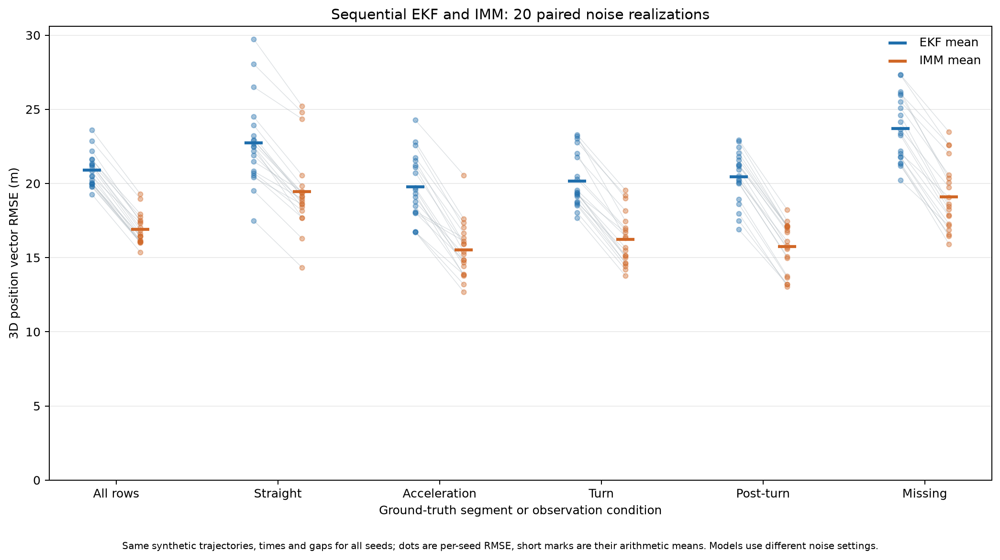
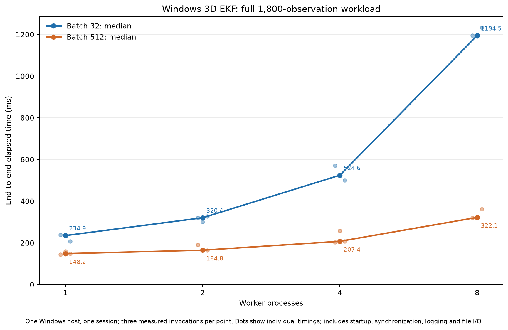

# CT-353 Operating Systems — CCA Presentation

This Markdown is the 12-slide presentation source. Each `---` separates slides. Links on each slide identify the evidence behind its figures; the limitations are part of the presentation.

## Slide 1: Project

**Cross-platform system calls and multi-process radar tracking**

Department of Computer Science & Information Technology, NED University

Muhammad Nouman Fazil · Muhammad Usman Murtaze · Muneeb ur Rehman

[Final report](../report/final_report.md)

---

## Slide 2: Objectives and resources

- Demonstrate OS interfaces for file I/O, processes, memory, IPC, and permissions on Linux and Windows.
- Integrate native file I/O, shared mapping, IPC, and worker processes into a Kalman tracker.
- Validate tracking and measure performance with reproducible inputs and stated limitations.
- Use C++17, Python standard-library verification, platform metrics, logs, and saved raw results.

---

## Slide 3: Native integration

```text
Radar measurements CSV → native file I/O → shared mapped batch
                                              ↓
                          persistent processes, one owner per track
                                              ↓
                           native output CSV → independent checks
```

Linux: `open`/`read`/`write`, shared `mmap`, `fork`, pipes. Windows: file handles, file mapping, `CreateProcess`, events. Worker state persists across batches; each track stays ordered. Native workers use the **3D EKF**; the IMM is a separate sequential extension.

[Architecture and verification](../docs/phase-3-parallel-ekf3d.md)

---

## Slide 4: Required interfaces and OS differences

| Category | Linux interfaces | Windows APIs |
|---|---|---|
| File | `open`, `read`, `write`, `close` | `CreateFile`, `ReadFile`, `WriteFile`, `CloseHandle` |
| Process | `fork`, `exec`, `wait` | `CreateProcess`, `WaitForSingleObject` |
| Memory | `mmap`, `munmap` | `VirtualAlloc`, `VirtualFree` |
| IPC | `pipe`, `shmget`, `shmat` | `CreatePipe`, `CreateFileMapping`, `MapViewOfFile` |
| Permissions | `chmod`, `chown`, `umask` | `SetFileSecurity` |

The rubric names 15 Linux interfaces and 12 Windows APIs, despite a 15-call heading; the Windows count needs instructor clarification. `fork` and `CreateProcess`, and POSIX modes and Windows security descriptors, have different semantics.

[Coverage matrix and evidence](../docs/phase-0-baseline.md#requirement-to-source-to-evidence-matrix)

---

## Slide 5: Radar EKF model

State: `x = [px, py, pz, vx, vy, vz, ax, ay, az]ᵀ`. The radar is at the origin and observes range, azimuth and elevation. A full covariance matrix links the coordinates.

```text
p′ = p + v Δt + ½a Δt²       v′ = v + a Δt       a′ = a
z  = [‖p‖, atan2(y,x), atan2(z,√(x²+y²))]ᵀ + noise
```

The EKF linearizes the radar measurement, wraps angle residuals, uses a Cholesky solve and Joseph covariance update, and predicts without correction when observations are missing. The process covariance models continuous white jerk, `q = 25 m²/s⁵`.

[Equations, parameters and tests](../docs/phase-2-ekf3d.md)

---

## Slide 6: Advanced extension — interacting multiple models

- A sequential IMM maintains constant-velocity and constant-acceleration EKF hypotheses in a common nine-coordinate state.
- At each observation, transition probabilities mix states and covariances; each model predicts and updates; likelihoods update model probabilities; estimates are fused.
- Model transition matrix: `[[0.97, 0.03], [0.03, 0.97]]` per observation. Missing measurements use prediction and transition only.
- Log-domain normalization avoids likelihood underflow. The CV acceleration coordinates are projected to zero after prediction.

The IMM is **not** the algorithm used by the native multi-process application. [Model and assumptions](../docs/phase-5-imm.md)

---

## Slide 7: Scenario and validation

- Seeded synthetic radar scenario: 3 tracks × 600 observations; irregular intervals, missing measurements, straight motion and maneuvers. Ground truth is separate from filter input.
- Native 1/2/4/8-worker EKF outputs were compared with the sequential driver, including interleaved tracks, batch boundaries, and 14,400-record expanded input.
- Independent numerical references check the EKF and IMM; the IMM reference checked all 1,800 seed-42 rows, including 123 gaps, against state, position covariance and probabilities.
- Failure-path tests exercise invalid input and worker failures; Linux CI verifies functional behavior on an Ubuntu runner.

[Scenario and EKF](../docs/phase-2-ekf3d.md) · [IMM reference](../tests/check_imm3d_reference.py) · [Native verification](../docs/phase-3-parallel-ekf3d.md)

---

## Slide 8: Accuracy on seeded radar data

Arithmetic mean of the **20 per-seed** all-row 3D vector RMSEs; each seed uses the same trajectories and gaps with different sensor noise:

| State | Single EKF | Sequential IMM |
|---|---:|---:|
| Position | 20.888 m | 16.891 m |
| Velocity | 24.655 m/s | 21.105 m/s |
| Acceleration | 6.245 m/s² | 1.907 m/s² |

The IMM was lower for these 20 seeds. Model noise settings differ, and this is one synthetic trajectory family; it does not establish general or real-world superiority. Missing rows are included.



[Per-seed evidence and segments](../results/phase5/multiseed-fe04715/README.md) · [Model probabilities](../results/phase5/multiseed-fe04715/seed42-probabilities.svg)

---

## Slide 9: Measured worker scaling

Local Windows 11, Ryzen 5 5600U; clean source commit `f6435cf`; seed 42, 1,800 observations, batch 512. Median complete native invocation from **three samples per configuration**:

| Workers | 1 | 2 | 4 | 8 |
|---|---:|---:|---:|---:|
| Time (ms) | 148.167 | 164.849 | 207.446 | 322.066 |
| Speedup vs one native worker | 1.000× | 0.899× | 0.714× | 0.460× |

This run shows slowdown. Timing includes process startup, input/output, synchronization, logging and shutdown; it does not isolate the cause. The benchmark varies workload and batch size and preserves individual samples.



[Protocol and raw results](../report/phase4_results.md)

---

## Slide 10: OS measurements and resource scope

- Category demos record call durations and process resource metrics; Linux TSC ticks and Windows process cycle counts differ in meaning.
- Integrated benchmark samples record parent CPU, summed worker CPU, parent peak memory and the largest individual worker peak; shared pages can appear in multiple processes.
- Launch time measures creation calls, not worker readiness. Later-batch time includes scheduling, synchronization and logging.
- The Ubuntu CI runner and the local Windows machine have different hardware and environments; these measurements **do not support a controlled OS performance comparison**.

[Measurement protocol](../docs/phase-4-measurements.md) · [Interface coverage](../docs/phase-0-baseline.md#requirement-to-source-to-evidence-matrix)

---

## Slide 11: IMM runtime and limitations

On the same seed-42 input, one Windows session with one warm-up and five measured **complete sequential invocations** produced medians of 90.230 ms for the EKF and 103.952 ms for the IMM. These timings include CSV I/O and startup and do not isolate computation.

The mean constant-acceleration probability varies by motion segment, but the differences are modest; the probabilities are not proven maneuver labels. Transition rates are per observation and the models use different noise parameters.

[Timing samples, hashes and accuracy](../results/phase5/windows-0e59a69/manifest.json) · [Multiple-seed analysis](../results/phase5/multiseed-fe04715/README.md)

---

## Slide 12: Conclusions and open work

- Native processes and IPC preserve independent track states across batches on both operating systems; reference checks support numerical correctness on tested inputs.
- The IMM adds model mixing and adaptive weights, with a measured accuracy/runtime tradeoff on the selected synthetic workload.
- More workers were slower in the recorded Windows run; comparable Linux/Windows experiments are still needed before drawing OS conclusions.
- The Windows 15-call counting ambiguity and the remaining setup/cleanup logging audit require attention before final submission.

Evidence: [Final report](../report/final_report.md) · [3D EKF results](../report/phase4_results.md) · [IMM documentation](../docs/phase-5-imm.md) · [Coverage matrix](../docs/phase-0-baseline.md#requirement-to-source-to-evidence-matrix)
