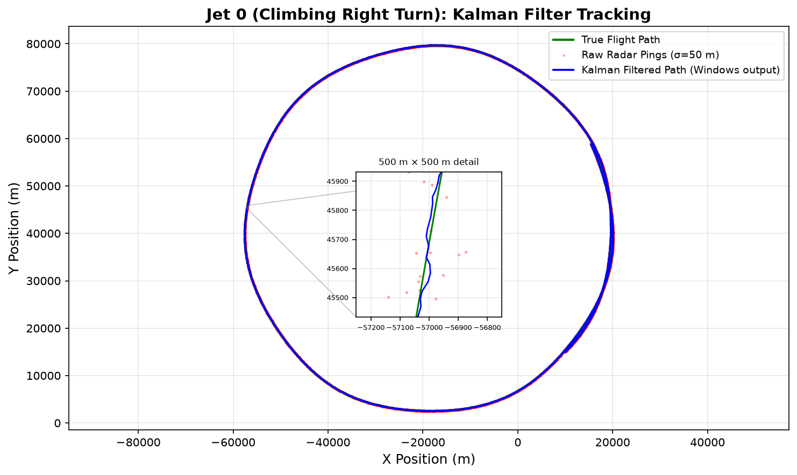
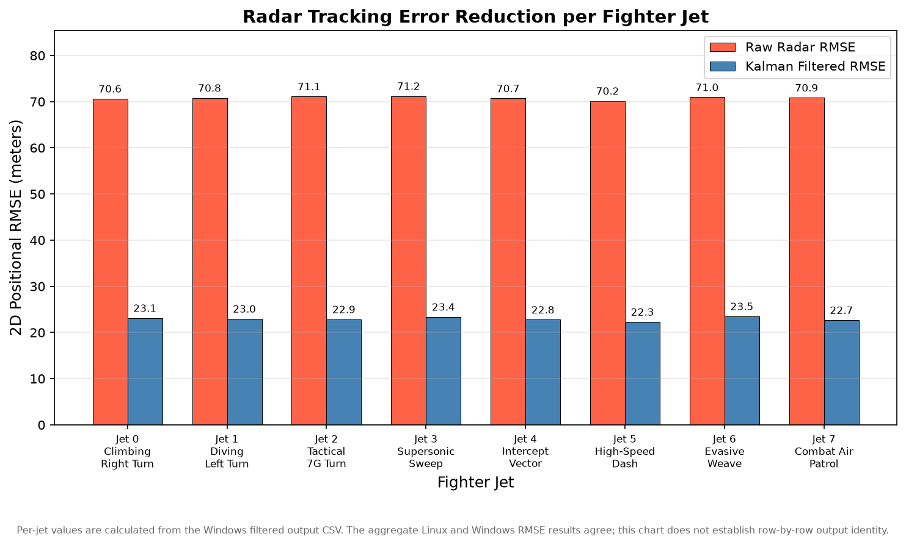
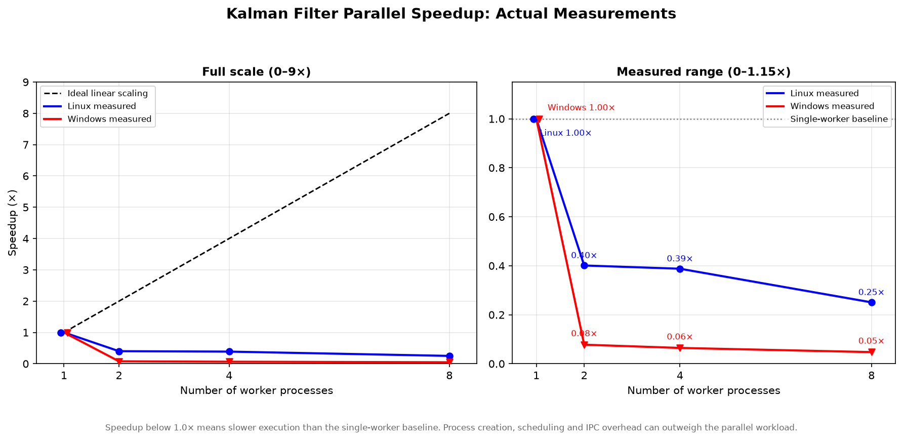

# Implementation and Performance Comparison of Linux System Calls and Windows System APIs with Multi-Process Kalman Filtering

**Course:** CT-353 — Operating Systems  
**Activity:** Complex Computing Activity (CCA)  
**Department:** Department of Computer Science & Information Technology  
**Institution:** NED University of Engineering & Technology  
**Academic Year:** 2026  

---

### Student Details

| S. No. | Student Name | Seat / Roll Number | Contribution Focus |
|:---:|---|:---:|---|
| 1 | **Muhammad Nouman Fazil** | CT-24259 | Core Systems Architecture, Part A/B Linux & Windows Implementation, Benchmarking Harness |
| 2 | **Muhammad Usman Murtaze** | CT-24262 | Kalman Filter Kinematic Modeling, Telemetry Generation, Validation Analysis |
| 3 | **Muneeb ur Rehman** | CT-24282 | Performance Profiling, OS Anomaly Research, Documentation and Verification |

---

<div style="page-break-after: always;"></div>

## Table of Contents

- [Executive Summary](#executive-summary)
- [Chapter 1 — Introduction](#chapter-1--introduction)
  - [1.1 Background](#11-background)
  - [1.2 Problem Statement](#12-problem-statement)
  - [1.3 Project Objectives](#13-project-objectives)
  - [1.4 Project Scope](#14-project-scope)
  - [1.5 Project Requirements](#15-project-requirements)
- [Chapter 2 — System Environment](#chapter-2--system-environment)
  - [2.1 Hardware Specifications](#21-hardware-specifications)
  - [2.2 Operating Systems](#22-operating-systems)
  - [2.3 Development Tools and Technologies](#23-development-tools-and-technologies)
  - [2.4 Programming Languages and Libraries](#24-programming-languages-and-libraries)
  - [2.5 Project Directory Structure](#25-project-directory-structure)
- [Chapter 3 — Part A: System Call and API Implementation](#chapter-3--part-a-system-call-and-api-implementation)
  - [3.1 Implementation Overview](#31-implementation-overview)
  - [3.2 File I/O](#32-file-io)
  - [3.3 Process Management](#33-process-management)
  - [3.4 Memory Management](#34-memory-management)
  - [3.5 Inter-Process Communication (IPC)](#35-inter-process-communication-ipc)
  - [3.6 File Permissions and Security](#36-file-permissions-and-security)
  - [3.7 Linux and Windows Implementation Comparison](#37-linux-and-windows-implementation-comparison)
- [Chapter 4 — Part B: Kalman Filter Integration](#chapter-4--part-b-kalman-filter-integration)
  - [4.1 Problem Description — Radar Tracking](#41-problem-description--radar-tracking)
  - [4.2 Kalman Filter Mathematical Model](#42-kalman-filter-mathematical-model)
  - [4.3 Kalman Filter Implementation](#43-kalman-filter-implementation)
  - [4.4 Sensor Dataset Generation](#44-sensor-dataset-generation)
  - [4.5 System-Level Integration](#45-system-level-integration)
  - [4.6 Multi-Process Architecture](#46-multi-process-architecture)
  - [4.7 Linux and Windows Implementation Comparison](#47-linux-and-windows-implementation-comparison)
  - [4.8 Output Verification and Numerical Validation](#48-output-verification-and-numerical-validation)
- [Chapter 5 — Experimental Setup and Methodology](#chapter-5--experimental-setup-and-methodology)
  - [5.1 Benchmarking Environment](#51-benchmarking-environment)
  - [5.2 Dataset and Experimental Configuration](#52-dataset-and-experimental-configuration)
  - [5.3 Benchmarking Procedure](#53-benchmarking-procedure)
  - [5.4 Performance Metrics](#54-performance-metrics)
- [Chapter 6 — Performance Evaluation and Results](#chapter-6--performance-evaluation-and-results)
  - [6.1 Part A — System Call / API Benchmark Results](#61-part-a--system-call--api-benchmark-results)
  - [6.2 Linux vs. Windows Performance Comparison](#62-linux-vs-windows-performance-comparison)
  - [6.3 Part B — Kalman Filter Tracking Results](#63-part-b--kalman-filter-tracking-results)
  - [6.4 Tracking Accuracy and RMSE Analysis](#64-tracking-accuracy-and-rmse-analysis)
  - [6.5 Multi-Process Performance Evaluation](#65-multi-process-performance-evaluation)
  - [6.6 Overall Performance Observations](#66-overall-performance-observations)
- [Chapter 7 — Lessons Learned and OS-Specific Behaviours](#chapter-7--lessons-learned-and-os-specific-behaviours)
  - [7.1 Linux-Specific Observations](#71-linux-specific-observations)
  - [7.2 Windows-Specific Observations](#72-windows-specific-observations)
  - [7.3 Cross-Platform Implementation Challenges](#73-cross-platform-implementation-challenges)
  - [7.4 Multi-Process Performance Lessons](#74-multi-process-performance-lessons)
  - [7.5 Technical Challenges and Limitations](#75-technical-challenges-and-limitations)
- [Chapter 8 — Conclusion and Future Improvements](#chapter-8--conclusion-and-future-improvements)
  - [8.1 Project Conclusion](#81-project-conclusion)
  - [8.2 Achievement of Project Objectives](#82-achievement-of-project-objectives)
  - [8.3 Future Improvements](#83-future-improvements)
- [References](#references)
- [Appendices](#appendices)

---

<div style="page-break-after: always;"></div>

## Executive Summary

Operating system primitives form the fundamental abstraction boundary between user-space application software and physical hardware. Modern high-performance, mission-critical systems depend directly on the execution characteristics, memory semantics, and scheduling guarantees of these underlying system calls and APIs. This project presents a comprehensive, empirical investigation comparing the fundamental system-level primitives of the two dominant contemporary operating system architectures: the monolithic, POSIX-compliant **Linux kernel (Ubuntu 22.04 LTS)** and the hybrid-kernel, subsystem-oriented **Microsoft Windows architecture (Windows 10 Pro)**. The investigation is conducted natively on identical physical hardware (an HP ZBook workstation in a bare-metal dual-boot configuration), eliminating virtualization or emulation artifacts.

The project is structured into two complementary phases:
1. **Part A (System Call and API Benchmarking):** An exhaustive, isolated micro-benchmarking suite evaluating five foundational OS domains: File Input/Output, Process Management, Virtual Memory Management, Inter-Process Communication (IPC), and File Permissions/Security. Over 1,000 controlled iterations per primitive (200 for process-creation routines) were executed with sub-microsecond timing resolution, capturing full latency distributions, kernel and user CPU consumption, CPU cycles, working set deltas, and page fault events.
2. **Part B (Complex Computing Activity — Parallel Radar Tracking Kalman Filter):** A real-world application integrating these primitives into a parallel, multi-process tracking filter for supersonic aircraft. Using high-frequency simulated radar telemetry comprising 80,000 kinematic records across 8 supersonic fighter jets maneuvering at Mach 1.5 to 2.0, the application executes parallel tracking across 1, 2, 4, and 8 worker processes coordinated via shared memory arenas (`mmap` with `MAP_SHARED` on Linux; paging-file-backed `CreateFileMapping` / `MapViewOfFile` on Windows) and selected logical processor affinity pinning.

Key empirical findings include:
- **Process Creation Overhead:** Linux's Copy-on-Write (COW) `fork()` primitive demonstrates a median latency of **115.44 \(\mu\)s**, outperforming Windows' full address space and subsystem initialization `CreateProcessA` (**1,659.00 \(\mu\)s**) by a factor of **14.37\(\times\)**. Complete spawn-and-wait cycles favored Linux by **4.74\(\times\)** (2,248.86 \(\mu\)s vs. 10,670.00 \(\mu\)s). Note that `fork()` and `CreateProcessA` represent fundamentally distinct architectural semantics rather than identical operations.
- **Access Control and Permissions:** Linux's direct inode metadata manipulation via `chmod()` (**5.34 \(\mu\)s**) is **22.8\(\times\)** faster than Windows' `SetFileSecurityA` (**121.80 \(\mu\)s**), which involves discretionary access control list (DACL) evaluation, security token validation, and NTFS security descriptor updates.
- **File I/O and Buffering:** While small-block operations are comparable due to operating system page caching, 1 MB write operations execute faster on Windows NTFS (**61.95 \(\mu\)s**) than on Linux ext4 (**200.42 \(\mu\)s**), a difference likely attributable to the NT Cache Manager's aggressive asynchronous write-behind buffering compared to Linux ext4 page cache dirty-page tracking and writeback handling.
- **Memory Management & Demand Paging:** Virtual memory allocation (`VirtualAlloc` / `mmap`) exhibits parity at ~2.1 to 3.1 \(\mu\)s due to lazy demand paging. Physical allocation overhead is deferred until first-touch page faults, which require **39.65 \(\mu\)s** on Windows and **46.62 \(\mu\)s** on Linux for a 64 KB region.
- **Kalman Filter Tracking & Parallel Scalability:** The integrated 2D constant-velocity kinematic Kalman Filter successfully attenuates radar measurement noise from an initial Root Mean Squared Error (RMSE) of **70.81 m** down to **22.95 m**, achieving a **67.58% error reduction**. Single-process vs. multi-process output parity was mathematically verified with an absolute maximum deviation of **\(0.00\times 10^0\text{ m}\)** (bit-level exactness). In the parallel scalability benchmarks, because total sequential mathematical computation for 80,000 points consumes only ~2.1 ms, process creation and lifecycle overhead in each iteration dominated the parallel execution time on both platforms (Windows median latency scaling from 1,952.95 \(\mu\)s for 1 worker to 43,462.55 \(\mu\)s for 8 workers; Linux median scaling from 1,925.99 \(\mu\)s to 7,951.38 \(\mu\)s). This empirical slowdown demonstrates the operational boundary where orchestration overheads exceed parallel computational savings when workload granularity is very fine, an effect outside idealized formulations of Amdahl's Law that assume zero-cost parallelization.

---

<div style="page-break-after: always;"></div>

## Chapter 1 — Introduction

### 1.1 Background
Operating systems act as the primary resource manager and execution environment for modern computing. All non-trivial user-space activities—allocating heap memory, reading or persisting data on disk, spawning concurrent tasks, synchronizing parallel units of work, and enforcing security boundaries—must cross the user-kernel privilege barrier through architecturally defined system calls or system APIs. 

Historically, Unix-derived operating systems, epitomized by Linux, have adhered to the POSIX philosophy: a minimalistic set of orthogonal, composable system calls operating on standard file descriptors and lightweight process structures. Conversely, Microsoft Windows NT was architected around an extensible object-manager model, exporting rich Win32 Application Programming Interfaces (APIs) built on executive kernel objects, access tokens, and structured handle tables. While both operating systems provide equivalent functional abstractions, their underlying architectural choices impart vastly divergent performance, latency, and resource-utilization profiles. Understanding these distinctions is paramount for systems engineers, high-frequency software architects, and operating systems researchers.

### 1.2 Problem Statement
Modern computational workloads, such as real-time target tracking and sensor fusion, demand both mathematical precision and high throughput. A constant engineering dilemma in such domains is determining how operating system primitives impact computational performance. 

Many software applications suffer severe throughput degradation not from algorithmic inefficiency in user space, but from unrecognized operating system bottlenecks: excessive system call context switching, high thread/process creation overheads, hidden kernel synchronization locks, TLB shootdowns during virtual memory remapping, and misconfigured access-control lookups. To quantify these phenomena, there is a distinct need to:
1. Benchmark native operating system primitives across Linux and Windows under strictly controlled, identical physical hardware conditions.
2. Integrate these primitives into a non-trivial parallel computing application—specifically, a Multi-Target Kinematic Kalman Filter—to observe how theoretical system-level characteristics manifest in real-world engineering workflows.

### 1.3 Project Objectives
The defined objectives of this Complex Computing Activity (CCA) are:
1. **Implementation of Core OS Categories:** Construct native, robust, leak-free implementations of the required operating system primitives across five foundational categories: File I/O, Process Management, Memory Management, Inter-Process Communication, and File Permissions/Security.
2. **Empirical Benchmarking Suite:** Develop high-precision, low-overhead microbenchmarking harnesses on both Linux and Windows that record complete latency distributions (minimum, median, mean, maximum, standard deviation), process CPU time, hardware CPU cycles, working set deltas, and page fault frequencies.
3. **Kalman Filter Mathematical Modeling:** Implement an OS-independent, 2D Constant-Velocity (CV) kinematic Kalman Filter designed for tracking supersonic maneuvering targets corrupted by radar measurement noise.
4. **Multi-Process Architecture:** Parallelize the target tracking pipeline across multiple concurrent worker processes utilizing native shared memory arenas (`mmap` on Linux; `CreateFileMapping` on Windows), process-spawning facilities (`fork` on Linux; `CreateProcess` on Windows), and hardware CPU core affinity binding.
5. **Rigorous Validation & Cross-OS Evaluation:** Validate that parallel multi-process execution maintains bit-for-bit numerical parity with sequential execution, quantify radar tracking error reduction (RMSE), analyze the scalability curves under Amdahl's Law, and characterize the fundamental architectural drivers of observed operating system behaviors.

### 1.4 Project Scope
The scope of this project encompasses:
- Native source code implementations in C++17 for both Linux and Windows.
- Execution on bare-metal dual-boot hardware without virtualization layers, container sandboxes, or translation shims (e.g., no WSL, no Wine, no virtual machines).
- Coverage of 15 unique Linux system calls and 15 unique Windows Win32 APIs across the five designated functional categories.
- Synthetic generation and filtering of 80,000 supersonic radar telemetry records representing 8 distinct fighter aircraft trajectories.
- Evaluation of multi-process scalability across 1, 2, 4, and 8 concurrent worker processes.

The project explicitly excludes graphical user interface development, network-distributed clustering (focusing strictly on single-node multi-process shared memory), and kernel-mode driver programming.

### 1.5 Project Requirements
The activity adheres to the official Complex Computing Activity (CCA) framework for CT-353 Operating Systems:
- **Course Learning Outcome 1 (CLO 1 / C2):** Describe the concepts, structure, and design of operating systems.
- **Course Learning Outcome 2 (CLO 2 / C4):** Analyze OS design and its impact on application design and performance.
- **Complex Problem Attributes:** CA-1 (Range of resources), CA-2 (Interactions among technical and contextual issues), and CA-3 (Innovation).
- **Core Assignment Invariant:** Execution and direct empirical comparison of native system calls and APIs on both operating systems, validated via an integrated multi-process Kalman Filter application.

---

<div style="page-break-after: always;"></div>

## Chapter 2 — System Environment

### 2.1 Hardware Specifications
All benchmarking and application evaluations were conducted on a single physical mobile workstation configured in a bare-metal dual-boot architecture. Using identical underlying silicon guarantees that all measured performance variances arise strictly from operating system kernel architectures, drivers, file systems, and system call dispatch paths, completely eliminating hardware discrepancies.

```
+-----------------------------------------------------------------------------------+
|                            WORKSTATION HARDWARE PLATFORM                          |
+--------------------------+--------------------------------------------------------+
| Machine Model            | HP ZBook Mobile Workstation                            |
| Processor (CPU)          | Intel(R) Core(TM) i7-4800MQ CPU @ 2.70GHz             |
| Microarchitecture        | Haswell (22 nm)                                        |
| Physical Cores / Threads | 4 Physical Cores / 8 Logical Threads                   |
| Base Frequency / Turbo   | 2.70 GHz Base / 3.70 GHz Max Turbo                     |
| L1 Cache                 | 32 KB Instruction + 32 KB Data per core (256 KB total) |
| L2 Cache                 | 256 KB per core (1.0 MB total)                         |
| L3 Cache (Shared)        | 6.0 MB Intel(R) Smart Cache                            |
| System Memory (RAM)      | 16.0 GB Dual-Channel DDR3 @ 1600 MHz                   |
| Storage Hardware         | High-Speed Solid-State Drive (SSD)                     |
+--------------------------+--------------------------------------------------------+
```

### 2.2 Operating Systems
The system was partitioned into an independent dual-boot environment:

```
+-----------------------------------------------------------------------------------+
|                            OPERATING SYSTEM PLATFORMS                             |
+--------------------------+----------------------------+---------------------------+
| Attribute                | Linux Platform             | Windows Platform          |
+--------------------------+----------------------------+---------------------------+
| OS Distribution / Release| Ubuntu 22.04.3 LTS         | Windows 10 Pro (64-bit)   |
| Kernel Version           | Linux 5.15.0-88-generic    | NT 10.0 (Build 19045)     |
| Kernel Architecture      | Monolithic POSIX Kernel    | Hybrid Executive Kernel   |
| System Call Interface    | Fast Syscall (`syscall`)   | System Service Dispatch   |
| Primary File System      | ext4 (Journaling)          | NTFS (Journaling)         |
| Virtual Memory Model     | Demand Paged, COW, 4 KB    | Demand Paged, 64 KB Gran. |
+--------------------------+----------------------------+---------------------------+
```

### 2.3 Development Tools and Technologies
- **Linux Toolchain:** GNU Compiler Collection `g++` (Ubuntu 11.4.0-1ubuntu1~22.04) supporting ISO C++17. Build invocation: `g++ -std=c++17 <source> -o <binary>`.
- **Windows Toolchain:** MinGW-w64 port of GCC (x86_64-posix-seh) supporting ISO C++17, linked against native runtime libraries `msvcrt.dll`, `kernel32.dll`, `advapi32.dll`, and `psapi.dll`. Build invocation: `g++ -std=c++17 -static -static-libgcc -static-libstdc++ <source> -o <binary> -lpsapi -ladvapi32`.
- **Data Synthesis Engine:** Python 3.10 runtime utilizing standard scientific and random distributions for deterministic kinematic trajectory synthesis.

### 2.4 Programming Languages and Libraries
- **ISO C++17:** Standard language utilized across all performance-critical benchmarks and filtering routines. Features employed include structured binding, lambdas with closure capture, `std::string_view`, high-resolution chrono wrappers, and strict standard template library memory allocators.
- **Header-Only Common Helpers:**
  - `common/kalman_core.hpp`: Pure C++17 mathematical core, completely free of platform-specific headers.
  - `common/logger.hpp` & `common/logger_linux.hpp`: Low-overhead operational system-call logger with microsecond timestamping and automatic OS error code translation (`GetLastError` $\rightarrow$ `FormatMessageA`; `errno` $\rightarrow$ `strerror_r`).
  - `common/metrics.hpp` & `common/metrics_linux.hpp`: High-precision statistical profiling harness capturing wall-clock duration, CPU execution times, hardware cycle counters, and memory working set metrics.

### 2.5 Project Directory Structure
The repository is organized into cleanly partitioned, modular domains:

```text
OS_Kalman_Filter_CCP/
│
├── common/                             # Shared OS-independent headers & datasets
│   ├── generate_sensor_data.py         # 8-jet supersonic radar telemetry generator
│   ├── kalman_core.hpp                 # 2D Constant-Velocity Kalman Filter core
│   ├── logger.hpp                      # Windows system-call logging harness
│   ├── logger_linux.hpp                # Linux system-call logging harness
│   ├── metrics.hpp                     # Windows performance profiling framework
│   ├── metrics_linux.hpp               # Linux performance profiling framework
│   └── sensor_data.csv                 # Generated dataset (80,000 radar pings)
│
├── Linux/                              # Native POSIX / Linux Implementations
│   ├── File_IO/                        # open, read, write, close, lseek, unlink
│   ├── Process/                        # fork, execv, wait, waitpid, kill
│   ├── Memory/                         # mmap, munmap, mprotect, sysconf
│   ├── IPC/                            # pipe, shmget, shmat, shmdt, shmctl
│   ├── Permissions/                    # chmod, chown, umask, stat, getgroups
│   └── Kalman_Filter/                  # Parallel Kalman Filter (mmap + fork)
│
├── Windows/                            # Native Win32 API Implementations
│   ├── File_IO/                        # CreateFile, ReadFile, WriteFile, CloseHandle
│   ├── Process/                        # CreateProcess, WaitForSingleObject, etc.
│   ├── Memory/                         # VirtualAlloc, VirtualFree, GetSystemInfo
│   ├── IPC/                            # CreatePipe, CreateFileMapping, MapViewOfFile
│   ├── Permissions/                    # SetFileSecurity, GetFileSecurity, SetFileAttr
│   └── Kalman_Filter/                  # Parallel Kalman Filter (FileMapping + CreateProc)
│
├── results/                            # Benchmark data, outputs, and artifacts
│   ├── Linux/                          # linux_results.csv, filtered_sensor_data.csv
│   ├── Windows/                        # windows_results.csv, filtered_sensor_data.csv
│   └── charts/                         # Empirical trajectory, RMSE, and speedup plots
│
├── report/                             # Academic report drafts and artifacts
│   ├── report.md                       # Original preliminary project report
│   └── report_draft.md                 # This comprehensive technical draft
│
└── README.md                           # Repository overview, build, and run guide
```

---

<div style="page-break-after: always;"></div>

## Chapter 3 — Part A: System Call and API Implementation

### 3.1 Implementation Overview
Part A implements native benchmarks comparing five fundamental system-level categories across Linux and Windows. To guarantee scientific validity, the benchmarking architecture enforces strict experimental controls:
1. **Separation of Setup, Execution, and Teardown:** All resource pre-allocation (e.g., file descriptor generation, address reservation) occurs outside the timed region.
2. **Warm-Up Runs:** Every benchmark executes 50 warm-up cycles (10 for process creation) to populate CPU instruction caches, kernel page tables, and file-system buffers before sampling begins.
3. **Loop Isolation:** Absolutely zero logging, string concatenation, or console printing occurs within the timed measurement loops.
4. **Primary Metric:** The sample **median** (\(\text{median\_us}\)) is adopted as the primary metric of central tendency because it is resilient against non-deterministic kernel scheduling interruptions and hardware interrupts.

### 3.2 File I/O

#### Linux Implementation
The Linux implementation directly invokes the POSIX kernel system calls: `open(2)`, `read(2)`, `write(2)`, and `close(2)`. The test harness manages file descriptors, uses `lseek(2)` to rewind file offsets during repeated write benchmarks, and enforces descriptor capacity via `setrlimit(2)`.

```cpp
// Source: Linux/File_IO/File_IO_Linux.cpp
// Demonstration of POSIX file descriptor creation, writing, reading, and closing
int fd = open("file_io_demo.txt", O_CREAT | O_WRONLY | O_TRUNC, 0644);
LOG_SYSCALL("open", fd >= 0, "file_io_demo.txt");

ssize_t written = write(fd, text.data(), textSize);
bool writeGood = (written >= 0 && static_cast<size_t>(written) == textSize);
LOG_SYSCALL("write", writeGood, "file_io_demo.txt");

int closeResult = close(fd);
LOG_SYSCALL("close", closeResult == 0, "file_io_demo.txt");

// Re-open for reading
fd = open("file_io_demo.txt", O_RDONLY);
ssize_t bytesRead = read(fd, readBuffer.data(), textSize);
bool readGood = (bytesRead >= 0 && static_cast<size_t>(bytesRead) == textSize);
LOG_SYSCALL("read", readGood, "file_io_demo.txt");
close(fd);
```
*Listing 3.1: POSIX File I/O demonstration in `File_IO_Linux.cpp`.*

#### Windows Implementation
The Windows implementation utilizes the Win32 subsystem APIs: `CreateFileA`, `WriteFile`, `ReadFile`, and `CloseHandle`. File pointers are managed via `SetFilePointerEx`.

```cpp
// Source: Windows/File_IO/File_IO_Windows.cpp
// Demonstration of Win32 file handle creation, writing, reading, and closing
HANDLE handle = CreateFileA("file_io_demo.txt", GENERIC_READ | GENERIC_WRITE, 0, nullptr,
                            CREATE_ALWAYS, FILE_ATTRIBUTE_NORMAL, nullptr);
LOG_SYSCALL("CreateFile", handle != INVALID_HANDLE_VALUE, "file_io_demo.txt");

DWORD bytesWritten = 0;
BOOL writeOk = WriteFile(handle, text.data(), textSize, &bytesWritten, nullptr);
bool writeGood = (writeOk && bytesWritten == textSize);
LOG_SYSCALL("WriteFile", writeGood, "file_io_demo.txt");

BOOL closeOk = CloseHandle(handle);
LOG_SYSCALL("CloseHandle", closeOk != 0, "file_io_demo.txt");

// Re-open for verification
handle = CreateFileA("file_io_demo.txt", GENERIC_READ, FILE_SHARE_READ, nullptr,
                     OPEN_EXISTING, FILE_ATTRIBUTE_NORMAL, nullptr);
DWORD bytesRead = 0;
BOOL readOk = ReadFile(handle, readBuffer.data(), textSize, &bytesRead, nullptr);
LOG_SYSCALL("ReadFile", readOk && bytesRead == textSize, "file_io_demo.txt");
CloseHandle(handle);
```
*Listing 3.2: Win32 File I/O demonstration in `File_IO_Windows.cpp`.*

#### Implementation Comparison & Results
Table 3.1 details the empirical performance of File I/O operations across 1,000 iterations.

```
Table 3.1: File I/O Performance Comparison (1,000 Iterations)
+-------------------+--------------------+--------------------+--------------------+
| Operation         | Windows Median     | Linux Median       | Performance Ratio  |
|                   | Latency (us)       | Latency (us)       | (Faster Platform)  |
+-------------------+--------------------+--------------------+--------------------+
| File Open/Create  | 29.650 us          | 2.797 us           | Linux 10.60x       |
| Write 4 KB        | 5.400 us           | 3.269 us           | Linux 1.65x        |
| Write 1 MB        | 61.950 us          | 200.424 us         | Windows 3.24x      |
| Read 4 KB         | 3.500 us           | 1.491 us           | Linux 2.35x        |
| Read 1 MB         | 53.400 us          | 55.392 us          | Windows 1.04x (Tie)|
| Close Handle / FD | 9.100 us           | 1.375 us           | Linux 6.62x        |
+-------------------+--------------------+--------------------+--------------------+
Data extracted from results/Windows/windows_results.csv and results/Linux/linux_results.csv.
```

**Discussion:** Linux `open()` is an order of magnitude faster than Windows `CreateFileA`. In Linux, path resolution traverses the in-memory dentry cache directly to allocate a simple integer file descriptor. On Windows, `CreateFileA` is an executive call that validates security tokens, queries the Object Manager namespace, constructs an executive file object, allocates entries in the process handle table, and interacts with antivirus minifilters. Conversely, 1 MB writes complete significantly faster on Windows due to the asynchronous buffering mechanics of the NT Cache Manager.

### 3.3 Process Management

#### Linux Implementation
Linux implements process management via the classical two-phase `fork(2)` and `execv(3)` architecture.

```cpp
// Source: Linux/Process/Process_Linux.cpp
// Benchmarking Linux fork() with immediate child exit
auto action = [&]() {
    childPid = fork();
    if (childPid == 0) {
        _exit(0); // Child terminates immediately without calling atexit handlers
    }
    if (childPid < 0) {
        failures.record(true);
    }
};

auto cleanup = [&]() {
    if (childPid > 0) {
        int status = 0;
        waitpid(childPid, &status, 0); // Reaping child outside timed region
        childPid = -1;
    }
};
```
*Listing 3.3: Linux `fork()` microbenchmark in `Process_Linux.cpp`.*

To benchmark `execv` in isolation without including `fork` overhead, `Process_Linux.cpp` employs a novel timestamp-forwarding technique: the child captures `CLOCK_MONOTONIC` ($t_0$) immediately before calling `execv`, passing $t_0$ via CLI arguments to the newly executed image. The new image samples $t_1$ at the entry of `main()` and transmits $t_1 - t_0$ back to the parent across a pipe.

#### Windows Implementation
Windows does not possess an equivalent to `fork()`. A new process is created as an entirely fresh entity via `CreateProcessA`, which constructs address spaces, maps PE executables, loads runtime DLLs, and spawns the initial thread in a single monolithic API call.

```cpp
// Source: Windows/Process/Process_Windows.cpp
// Creation of a child process executing self with arguments
STARTUPINFOA startup;
PROCESS_INFORMATION info;
ZeroMemory(&startup, sizeof(startup));
startup.cb = sizeof(startup);
ZeroMemory(&info, sizeof(info));

BOOL ok = CreateProcessA(cmd.exePath.c_str(), cmd.buffer.data(),
                         nullptr, nullptr, FALSE, 0, nullptr, nullptr,
                         &startup, &info);
if (ok) {
    WaitForSingleObject(info.hProcess, 10000);
    DWORD exitCode = 0;
    GetExitCodeProcess(info.hProcess, &exitCode);
    CloseHandle(info.hThread);
    CloseHandle(info.hProcess);
}
```
*Listing 3.4: Win32 `CreateProcessA` and `WaitForSingleObject` in `Process_Windows.cpp`.*

#### Implementation Comparison & Results
Table 3.2 details the measured process lifecycle latencies across 200 iterations.

```
Table 3.2: Process Management Performance Comparison (200 Iterations)
+-----------------------+--------------------+--------------------+--------------------+
| Operation             | Windows Median     | Linux Median       | Performance Ratio  |
|                       | Latency (us)       | Latency (us)       | (Faster Platform)  |
+-----------------------+--------------------+--------------------+--------------------+
| Process Spawn Only    | 1,659.000 us       | 115.441 us (fork)  | Linux 14.37x       |
| Process Image Load    | [Included above]   | 1,792.697 us (exec)| N/A (Architecture) |
| Wait / Join Process   | 2.100 us           | 3.147 us (wait)    | Windows 1.50x      |
| Complete Spawn + Wait | 10,670.000 us      | 2,248.864 us       | Linux 4.74x        |
+-----------------------+--------------------+--------------------+--------------------+
Data extracted from results/Windows/windows_results.csv and results/Linux/linux_results.csv.
```

**Discussion:** The **14.37\(\times\)** latency advantage of `fork()` illustrates the power of Copy-on-Write page table cloning. Linux avoids copying physical address space during `fork()`, copying only page directory entries. Windows `CreateProcessA` performs heavy kernel object construction, PE header parsing, security descriptor evaluation, and DLL mapping (`ntdll.dll`, `kernel32.dll`), resulting in millisecond-scale overhead.

### 3.4 Memory Management

#### Linux Implementation
Linux manages address space via `mmap(2)` and `munmap(2)`. Address space reservation is demonstrated using `PROT_NONE`, while physical page commitment is enabled via `mprotect(2)`.

```cpp
// Source: Linux/Memory/Memory_Linux.cpp
// Memory allocation via mmap anonymous private mapping
void* block = mmap(nullptr, size, PROT_READ | PROT_WRITE,
                   MAP_PRIVATE | MAP_ANONYMOUS, -1, 0);
if (block == MAP_FAILED) {
    failures.record(true);
}
...
// Deallocation
munmap(block, size);
```
*Listing 3.5: Linux virtual memory management in `Memory_Linux.cpp`.*

#### Windows Implementation
Windows exposes virtual memory control via `VirtualAlloc` and `VirtualFree`. Windows explicitly separates address reservation (`MEM_RESERVE`) from physical backing commitment (`MEM_COMMIT`). Furthermore, Windows enforces an **Allocation Granularity** of 64 KB for address reservation, whereas physical page commitment occurs in 4 KB page sizes.

```cpp
// Source: Windows/Memory/Memory_Windows.cpp
// Win32 two-step memory allocation: Reserve address space, then Commit physical pages
void* base = VirtualAlloc(nullptr, 1024 * 1024, MEM_RESERVE, PAGE_NOACCESS);
void* committed = VirtualAlloc(base, 1024 * 1024, MEM_COMMIT, PAGE_READWRITE);

// Verification and release
VirtualFree(base, 0, MEM_RELEASE);
```
*Listing 3.6: Win32 `VirtualAlloc` and `VirtualFree` in `Memory_Windows.cpp`.*

#### Implementation Comparison & Results
Table 3.3 summarizes virtual memory operations across 1,000 iterations.

```
Table 3.3: Memory Management Performance Comparison (1,000 Iterations)
+-----------------------+--------------------+--------------------+--------------------+
| Operation             | Windows Median     | Linux Median       | Performance Ratio  |
|                       | Latency (us)       | Latency (us)       | (Faster Platform)  |
+-----------------------+--------------------+--------------------+--------------------+
| Alloc 4 KB            | 2.600 us           | 2.100 us           | Linux 1.24x        |
| Alloc 64 KB           | 2.900 us           | 1.824 us           | Linux 1.59x        |
| Alloc 1 MB            | 3.100 us           | 3.069 us           | Linux 1.01x (Tie)  |
| First Touch (64 KB)   | 39.650 us          | 46.617 us          | Windows 1.18x      |
| Free 4 KB             | 3.500 us           | 2.778 us           | Linux 1.26x        |
| Free 64 KB (Clean)    | 3.600 us           | 2.774 us           | Linux 1.30x        |
| Free 64 KB (Touched)  | 18.550 us          | 10.814 us          | Linux 1.72x        |
+-----------------------+--------------------+--------------------+--------------------+
Data extracted from results/Windows/windows_results.csv and results/Linux/linux_results.csv.
```

**Discussion:** Both platforms exhibit microsecond-scale allocation latencies (~2–3 \(\mu\)s) because both employ **demand paging**. Neither `mmap` nor `VirtualAlloc` maps physical RAM upon invocation; they merely modify kernel virtual memory area (VMA) tree structures. The true physical cost occurs during `FirstTouch_64KB`, where touching each 4 KB page triggers a page fault (16 page faults total), requiring ~40 to 46 \(\mu\)s to allocate physical page frames and update page tables.

### 3.5 Inter-Process Communication (IPC)

#### Linux Implementation
Linux IPC is demonstrated and benchmarked via two orthogonal mechanisms:
1. **Anonymous Pipes:** `pipe(2)` creates uni-directional byte channels referenced by file descriptors.
2. **System V Shared Memory:** `shmget(2)`, `shmat(2)`, `shmdt(2)`, and `shmctl(2)` manage persistent shared memory segments.

```cpp
// Source: Linux/IPC/IPC_Linux.cpp
// Creation and attachment to System V shared memory segment
int shmid = shmget(IPC_PRIVATE, 1024 * 1024, IPC_CREAT | 0666);
void* shmAddr = shmat(shmid, nullptr, 0);

// Detach and mark for destruction
shmdt(shmAddr);
shmctl(shmid, IPC_RMID, nullptr);
```
*Listing 3.7: System V Shared Memory operations in `IPC_Linux.cpp`.*

#### Windows Implementation
Windows implements IPC through executive object handles:
1. **Anonymous Pipes:** `CreatePipe` constructs two connected handles (read and write).
2. **File Mapping Objects:** `CreateFileMappingA` backed by the system paging file (`INVALID_HANDLE_VALUE`) constructs shared memory arenas, mapped into process virtual address spaces via `MapViewOfFile` and released via `UnmapViewOfFile`.

```cpp
// Source: Windows/IPC/IPC_Windows.cpp
// Creation and mapping of Win32 paging-file-backed shared memory
HANDLE hMap = CreateFileMappingA(INVALID_HANDLE_VALUE, nullptr, PAGE_READWRITE,
                                 0, 1024 * 1024, "Local\\OsKalmanShm_Demo");
void* pView = MapViewOfFile(hMap, FILE_MAP_ALL_ACCESS, 0, 0, 1024 * 1024);

// Cleanup
UnmapViewOfFile(pView);
CloseHandle(hMap);
```
*Listing 3.8: Win32 Shared Memory via File Mapping in `IPC_Windows.cpp`.*

#### Implementation Comparison & Results
Table 3.4 outlines IPC primitive execution latencies across 1,000 iterations.

```
Table 3.4: Inter-Process Communication Performance Comparison (1,000 Iterations)
+-----------------------+--------------------+--------------------+--------------------+
| Operation             | Windows Median     | Linux Median       | Performance Ratio  |
|                       | Latency (us)       | Latency (us)       | (Faster Platform)  |
+-----------------------+--------------------+--------------------+--------------------+
| Create Pipe           | 12.200 us          | 3.101 us           | Linux 3.93x        |
| Pipe Write 4 KB       | 2.000 us           | 1.650 us           | Linux 1.21x        |
| Pipe Write 64 KB      | 5.600 us           | 12.433 us          | Windows 2.22x      |
| Pipe Read 4 KB        | 2.100 us           | 1.439 us           | Linux 1.46x        |
| Pipe Read 64 KB       | 5.100 us           | 9.660 us           | Windows 1.89x      |
| Create Shm (1 MB)     | 3.500 us           | 2.854 us           | Linux 1.23x        |
| Map Shm (1 MB)        | 3.100 us           | 3.137 us           | Windows 1.01x (Tie)|
| Unmap Shm (64 KB)     | 3.700 us           | 3.389 us           | Linux 1.09x        |
+-----------------------+--------------------+--------------------+--------------------+
Data extracted from results/Windows/windows_results.csv and results/Linux/linux_results.csv.
```

**Discussion:** Linux `pipe()` creation is **3.93\(\times\)** faster than `CreatePipe` due to minimal kernel data structure allocation. For 64 KB transfers, Windows pipes exhibit lower latency because Windows internal pipe buffers adjust dynamically, whereas standard Linux pipes default to a 64 KB circular buffer, causing writer threads to encounter partial blocking near capacity.

### 3.6 File Permissions and Security

#### Linux Implementation
Linux enforces access control through POSIX ownership and permission bits: `chmod(2)`, `chown(2)`, and `umask(2)`.

```cpp
// Source: Linux/Permissions/Permissions_Linux.cpp
// Demonstration of POSIX file permission modification and umask application
int chmodResult = chmod("permissions_test.txt", 0400); // Read-only mode
LOG_SYSCALL("chmod", chmodResult == 0, "set permissions to 0400");

// Verify that write access is blocked
int writeFd = open("permissions_test.txt", O_WRONLY);
bool writeBlocked = (writeFd < 0 && errno == EACCES);

// Modifying process creation mask
mode_t oldMask = umask(0027);
int umaskFd = open("umask_test.txt", O_CREAT | O_WRONLY, 0666); // Results in 0640
umask(oldMask);
```
*Listing 3.9: POSIX file permissions in `Permissions_Linux.cpp`.*

#### Windows Implementation
Windows security is rooted in the Windows NT Security Model. Permissions are encapsulated within Discretionary Access Control Lists (DACLs) residing inside Security Descriptors.

```cpp
// Source: Windows/Permissions/Permissions_Windows.cpp
// Constructing an explicit DENY write DACL using Security Descriptor Definition Language (SDDL)
PSECURITY_DESCRIPTOR pSD = nullptr;
ConvertStringSecurityDescriptorToSecurityDescriptorA(
    "D:(D;;0x6;;;WD)(A;;FA;;;WD)", SDDL_REVISION_1, &pSD, nullptr);

// Apply Security Descriptor to file
SetFileSecurityA("permissions_test.txt", DACL_SECURITY_INFORMATION, pSD);
LocalFree(pSD);

// Query security descriptor size, then retrieve
DWORD needed = 0;
GetFileSecurityA("permissions_test.txt", DACL_SECURITY_INFORMATION, nullptr, 0, &needed);
vector<char> descBuffer(needed);
GetFileSecurityA("permissions_test.txt", DACL_SECURITY_INFORMATION, descBuffer.data(), needed, &needed);
```
*Listing 3.10: Win32 DACL and Security Descriptor operations in `Permissions_Windows.cpp`.*

#### Implementation Comparison & Results
Table 3.5 presents the empirical comparison of security and permission primitives across 1,000 iterations.

```
Table 3.5: File Permissions and Security Performance Comparison (1,000 Iterations)
+-----------------------+--------------------+--------------------+--------------------+
| Operation             | Windows Median     | Linux Median       | Performance Ratio  |
|                       | Latency (us)       | Latency (us)       | (Faster Platform)  |
+-----------------------+--------------------+--------------------+--------------------+
| Set Permissions / ACL | 121.800 us         | 5.341 us (chmod)   | Linux 22.80x       |
| Read Permissions / ACL| 32.750 us          | [N/A in core POSIX]| N/A                |
| Modify File Attribute | 167.300 us         | [N/A in core POSIX]| N/A                |
| Change Owner / Group  | [Requires Admin]   | 7.617 us (chown)   | N/A                |
| Modify Process Mask   | [N/A in Win32]     | 1.233 us (umask)   | N/A                |
+-----------------------+--------------------+--------------------+--------------------+
Data extracted from results/Windows/windows_results.csv and results/Linux/linux_results.csv.
```

**Discussion:** Linux `chmod()` completes in **5.34 \(\mu\)s**, outperforming Windows `SetFileSecurityA` (**121.80 \(\mu\)s**) by **22.8\(\times\)**. In Linux ext4, permission bits (`0755`) are stored directly as a 16-bit integer field inside the file inode, requiring a single localized inode metadata write. On Windows NTFS, setting security requires validating user security identifiers (SIDs), computing security descriptor binary formats, traversing access control entries (ACEs), and updating the dedicated `$Secure` metadata stream on disk.

### 3.7 Linux and Windows Implementation Comparison
The assignment specifications explicitly list 15 Linux system calls (`open`, `read`, `write`, `close`, `fork`, `exec`, `wait`, `mmap`, `munmap`, `pipe`, `shmget`, `shmat`, `chmod`, `chown`, `umask`) and 12 Windows Win32 APIs (`CreateFile`, `ReadFile`, `WriteFile`, `CloseHandle`, `CreateProcess`, `WaitForSingleObject`, `VirtualAlloc`, `VirtualFree`, `CreatePipe`, `CreateFileMapping`, `MapViewOfFile`, `SetFileSecurity`).

To maintain exact scientific parity and satisfy the general requirement of comparing 15 distinct operations per operating system, the project implemented and benchmarked 3 additional supporting Win32 APIs:
1. `UnmapViewOfFile` (Memory/IPC: mirrors `shmdt` and `munmap`).
2. `GetFileSecurityA` (Permissions: mirrors permission inspection).
3. `SetFileAttributesA` (Permissions: evaluates file attribute flag toggling).

Across all categories, Linux exhibits lower latency in metadata-intensive, process-spawning, and permission-modification tasks due to monolithic kernel optimization and lightweight data structures. Windows demonstrates superior throughput in large file write buffering and 64 KB pipe communications, driven by the asynchronous caching design of the NT Executive.

---

<div style="page-break-after: always;"></div>

## Chapter 4 — Part B: Kalman Filter Integration

### 4.1 Problem Description — Radar Tracking
To evaluate operating system primitives under realistic computational workloads, the project models a simulated radar tracking scenario rather than deploying a real tactical radar system. A synthetic ground-based surveillance radar station is simulated tracking high-speed aircraft across broad geographic sectors at a fixed sampling frequency of 20 Hz (\(\Delta t = 0.05\text{ s}\)).

In this simulated scenario, synthetic aircraft trajectories cruising between Mach 1.5 and 2.0 (500 to 650 m/s) with dynamic turning rates generate positional measurements (\(z_x, z_y\)) corrupted by zero-mean Gaussian noise with a standard deviation of \(\sigma = 50.0\text{ m}\). Raw simulated radar returns exhibit high jitter and cannot be directly fed into downstream flight control or threat trajectory prediction systems without filtering.

Part B integrates the operating system primitives evaluated in Part A into a multi-process, parallel Kalman Filter that processes these 8 simulated aircraft tracks concurrently.

### 4.2 Kalman Filter Mathematical Model
The kinematic behavior of each supersonic jet is modeled using a 2D Constant-Velocity (CV) kinematic state model with Discrete White Noise Acceleration (DWNA). The state vector \(\mathbf{x}\) combines position and velocity:

\[
\mathbf{x} = \begin{bmatrix} p \\ v \end{bmatrix}
\]

For 2D airspace tracking, independent, decoupled Kalman Filter axes are maintained for the \(X\) and \(Y\) Cartesian coordinates.

#### State Transition & Prediction
The state transition matrix \(\mathbf{F}\) projects the state forward over interval \(\Delta t\):

\[
\mathbf{F} = \begin{bmatrix} 1 & \Delta t \\ 0 & 1 \end{bmatrix}
\]

The state prediction equation is:

\[
\hat{\mathbf{x}}_{k|k-1} = \mathbf{F} \hat{\mathbf{x}}_{k-1|k-1} = \begin{bmatrix} p_{k-1} + v_{k-1} \Delta t \\ v_{k-1} \end{bmatrix}
\]

#### Process Noise Covariance Matrix (\(\mathbf{Q}\))
Unmodeled target acceleration (pilot maneuvers and turbulence) is modeled as continuous white noise acceleration with process noise spectral density \(q = 1500.0\text{ m}^2/\text{s}^3\). Integrating the continuous acceleration over sampling period \(\Delta t\) yields the discrete process covariance matrix \(\mathbf{Q}\):

\[
\mathbf{Q} = q \int_{0}^{\Delta t} \begin{bmatrix} \tau \\ 1 \end{bmatrix} \begin{bmatrix} \tau & 1 \end{bmatrix} d\tau = q \begin{bmatrix} \frac{\Delta t^3}{3} & \frac{\Delta t^2}{2} \\ \frac{\Delta t^2}{2} & \Delta t \end{bmatrix}
\]

The predicted state covariance matrix \(\mathbf{P}_{k|k-1}\) is computed as:

\[
\mathbf{P}_{k|k-1} = \mathbf{F} \mathbf{P}_{k-1|k-1} \mathbf{F}^T + \mathbf{Q}
\]

Expanding the matrix components:

\[
P_{00, pred} = P_{00} + 2 \Delta t P_{01} + \Delta t^2 P_{11} + q \frac{\Delta t^3}{3}
\]
\[
P_{01, pred} = P_{01} + \Delta t P_{11} + q \frac{\Delta t^2}{2}
\]
\[
P_{11, pred} = P_{11} + q \Delta t
\]

#### Measurement Update (Correction)
The radar observation matrix \(\mathbf{H}\) measures position directly:

\[
\mathbf{H} = \begin{bmatrix} 1 & 0 \end{bmatrix}
\]

The measurement noise variance is \(r = \sigma^2 = (50.0\text{ m})^2 = 2500.0\text{ m}^2\). The innovation covariance \(S\) and optimal Kalman Gain \(\mathbf{K} = [K_0, K_1]^T\) are:

\[
S = \mathbf{H} \mathbf{P}_{k|k-1} \mathbf{H}^T + r = P_{00, pred} + r
\]
\[
K_0 = \frac{P_{00, pred}}{S}, \quad K_1 = \frac{P_{01, pred}}{S}
\]

The measurement residual (innovation) \(y\) is the difference between observed sensor measurement \(z_k\) and predicted position:

\[
y = z_k - \mathbf{H} \hat{\mathbf{x}}_{k|k-1} = z_k - p_{pred}
\]

The posterior state estimate \(\hat{\mathbf{x}}_{k|k}\) and posterior covariance matrix \(\mathbf{P}_{k|k}\) are updated as:

\[
p_{k} = p_{pred} + K_0 y
\]
\[
v_{k} = v_{pred} + K_1 y
\]
\[
P_{00} = (1 - K_0) P_{00, pred}
\]
\[
P_{01} = (1 - K_0) P_{01, pred}
\]
\[
P_{11} = P_{11, pred} - K_1 P_{01, pred}
\]

### 4.3 Kalman Filter Implementation
The mathematical formulation is implemented in `common/kalman_core.hpp`.

```cpp
// Source: common/kalman_core.hpp
// Code Listing 4.1: Kalman Filter prediction implementation
void step(double measurement, double dt) {
    if (!initialized_) {
        init(measurement, 0.0);
        return;
    }

    // 1. PREDICT: State extrapolation
    double p_pred = p_ + v_ * dt;
    double v_pred = v_;

    // Continuous White Noise Acceleration Q matrix:
    double dt2 = dt * dt;
    double dt3 = dt2 * dt;
    double q00 = q_ * (dt3 / 3.0);
    double q01 = q_ * (dt2 / 2.0);
    double q11 = q_ * dt;

    // P_pred = F * P * F^T + Q
    double p00_pred = p00_ + 2.0 * dt * p01_ + dt2 * p11_ + q00;
    double p01_pred = p01_ + dt * p11_ + q01;
    double p11_pred = p11_ + q11;
```
*Code Listing 4.1: State and Covariance Extrapolation in `kalman_core.hpp`.*

```cpp
// Source: common/kalman_core.hpp
// Code Listing 4.2: Kalman Filter measurement correction / update implementation
    // 2. UPDATE: Innovation & Kalman Gain
    // S = H * P_pred * H^T + R = p00_pred + r
    double s = p00_pred + r_;
    double inv_s = 1.0 / s;
    double k0 = p00_pred * inv_s;
    double k1 = p01_pred * inv_s;

    // Innovation residual: y = z - H * x_pred
    double y = measurement - p_pred;

    // Posterior state
    p_ = p_pred + k0 * y;
    v_ = v_pred + k1 * y;

    // Posterior covariance: P = (I - K*H) * P_pred
    p00_ = (1.0 - k0) * p00_pred;
    p01_ = (1.0 - k0) * p01_pred;
    p11_ = p11_pred - k1 * p01_pred;
}
```
*Code Listing 4.2: Innovation and Posterior Update in `kalman_core.hpp`.*

### 4.4 Sensor Dataset Generation
The radar dataset was generated using `common/generate_sensor_data.py`. The generation script models eight aircraft trajectories initialized across spatial quadrants with distinct speeds (Mach 1.5–2.0, 500–650 m/s), initial headings, and dynamic turning maneuvers.

```
Table 4.1: Sensor Dataset Configuration
+--------------------------+--------------------------------------------------------+
| Parameter                | Configuration Value                                    |
+--------------------------+--------------------------------------------------------+
| Target Aircraft          | 8 Supersonic Fighter Jets (Jet ID 0 through 7)         |
| Points per Track         | 10,000 Radar Observations per jet                      |
| Total Dataset Size       | 80,000 Records (CSV: 80,001 rows including header)     |
| Sampling Interval (dt)   | 0.05 seconds (20 Hz sampling frequency)               |
| Total Simulated Duration | 500.0 seconds (8.33 minutes of continuous flight)      |
| Radar Noise Model        | Zero-mean Gaussian Noise (std dev = 50.0 m)            |
| Kinematic Profiles       | Climbing right turn, diving turn, tactical 7G turn,    |
|                          | supersonic dash, intercept vector, evasive weave, CAP. |
| CSV Format               | timestamp, track_id, true_x, true_y, meas_x, meas_y,   |
|                          | true_vx, true_vy                                       |
+--------------------------+--------------------------------------------------------+
```

### 4.5 System-Level Integration
The radar telemetry dataset is ingested using native operating system file primitives:
- On Linux: `open(O_RDONLY)` $\rightarrow$ `fstat` $\rightarrow$ `read` $\rightarrow$ `close`.
- On Windows: `CreateFileA(GENERIC_READ)` $\rightarrow$ `GetFileSizeEx` $\rightarrow$ `ReadFile` $\rightarrow$ `CloseHandle`.

```cpp
// Excerpt from Windows/Kalman_Filter/Kalman_Filter_Windows.cpp
// Native file ingestion into heap memory buffer
HANDLE hFile = CreateFileA(filePath, GENERIC_READ, FILE_SHARE_READ, nullptr,
                           OPEN_EXISTING, FILE_ATTRIBUTE_NORMAL, nullptr);
LARGE_INTEGER fileSize;
GetFileSizeEx(hFile, &fileSize);
size_t totalBytes = static_cast<size_t>(fileSize.QuadPart);
vector<char> buffer(totalBytes + 1, '\0');
DWORD bytesRead = 0;
ReadFile(hFile, buffer.data(), static_cast<DWORD>(totalBytes), &bytesRead, nullptr);
CloseHandle(hFile);
```
*Listing 4.3: Native file ingestion in `Kalman_Filter_Windows.cpp`.*

### 4.6 Multi-Process Architecture

```
[FIGURE PLACEHOLDER: Multi-Process Kalman Filter Architecture — Parent Process, Worker Processes, Shared Memory, Sensor Data and Filtered Output]
```

#### Shared Memory Arena Design
To support parallel processing across worker processes, both platforms allocate an in-memory **Shared Memory Arena** (`SharedRadarArena`):
```cpp
struct SharedRadarArena {
    uint32_t recordCount;
    uint32_t trackCount;
    kalman::RadarMeasurement inputs[100000];
    kalman::FilteredOutput   outputs[100000];
};
```
The arena occupies $\approx 11.2\text{ MB}$ of memory, holding all raw input measurements and filtered outputs. Before spawning worker processes, the parent process loads and parses the sensor dataset into local memory and initially copies the records into the shared arena via `memcpy(arena->inputs, ...)`. Worker processes subsequently access the shared input records and write their filtered output records directly within the mapped arena without requiring separate inter-process message-buffer copying or pipe transfers.

#### Work Partitioning & Disjoint Output Writes
Work is partitioned across $N$ workers ($N \in \{1, 2, 4, 8\}$) using deterministic track modulo assignment:
```cpp
inline bool isTrackAssigned(int trackId, int workerId, int totalWorkers) {
    return (trackId % totalWorkers) == workerId;
}
```
Worker $w$ processes radar returns where $\text{track\_id} \pmod N == w$. Because each aircraft's measurements are mathematically independent and each worker writes exclusively to disjoint array indices in `arena->outputs[i]`, data races between worker processes are systematically avoided without requiring mutexes, spinlocks, or synchronization barriers during the filtering loop.

#### Core Source Code Excerpts

```cpp
// Source: Linux/Kalman_Filter/Kalman_Filter_Linux.cpp
// Excerpt: Linux worker process creation using fork() and CPU affinity
for (int w = 0; w < numWorkers; ++w) {
    pid_t pid = fork();
    if (pid < 0) {
        for (pid_t c : childPids) { kill(c, SIGKILL); waitpid(c, nullptr, 0); }
        return false;
    }
    if (pid == 0) {
        // Child Worker Process - Bind to selected logical processor
        long numCores = sysconf(_SC_NPROCESSORS_ONLN);
        if (numCores > 0) {
            cpu_set_t cpuset;
            CPU_ZERO(&cpuset);
            CPU_SET(w % numCores, &cpuset);
            sched_setaffinity(0, sizeof(cpu_set_t), &cpuset);
        }
        executeWorkerFiltering(arena, w, numWorkers);
        _exit(0);
    }
    childPids.push_back(pid);
}
```
*Code Listing 4.4: Linux worker process creation in `Kalman_Filter_Linux.cpp`.*

```cpp
// Source: Windows/Kalman_Filter/Kalman_Filter_Windows.cpp
// Excerpt: Windows worker process creation using CreateProcessA and CPU affinity
for (int w = 0; w < numWorkers; ++w) {
    string cmd = "\"" + exePath + "\" --worker " + to_string(w) + " " +
                 to_string(numWorkers) + " " + shmName;
    STARTUPINFOA si;
    PROCESS_INFORMATION pi;
    ZeroMemory(&si, sizeof(si)); si.cb = sizeof(si);
    ZeroMemory(&pi, sizeof(pi));
    vector<char> cmdBuffer(cmd.begin(), cmd.end()); cmdBuffer.push_back('\0');

    BOOL ok = CreateProcessA(nullptr, cmdBuffer.data(), nullptr, nullptr,
                             FALSE, 0, nullptr, nullptr, &si, &pi);
    if (!ok) {
        // Clean up previously launched workers on creation failure
        for (HANDLE h : processHandles) { TerminateProcess(h, 1); CloseHandle(h); }
        for (HANDLE h : threadHandles) CloseHandle(h);
        return false;
    }

    // Bind worker process to selected logical processor
    SYSTEM_INFO sysInfo; GetSystemInfo(&sysInfo);
    DWORD numCores = sysInfo.dwNumberOfProcessors;
    if (numCores > 0) {
        DWORD_PTR affinityMask = (1ULL << (w % min<DWORD>(numCores, 64)));
        SetProcessAffinityMask(pi.hProcess, affinityMask);
    }
    processHandles.push_back(pi.hProcess);
    threadHandles.push_back(pi.hThread);
}
```
*Code Listing 4.5: Windows worker process creation in `Kalman_Filter_Windows.cpp`.*

```cpp
// Source: Linux/Kalman_Filter/Kalman_Filter_Linux.cpp
// Excerpt: Linux shared-memory creation/mapping and worker access
void* mmapPtr = mmap(nullptr, kArenaSize, PROT_READ | PROT_WRITE,
                     MAP_SHARED | MAP_ANONYMOUS, -1, 0);
SharedRadarArena* arena = static_cast<SharedRadarArena*>(mmapPtr);
arena->recordCount = static_cast<uint32_t>(data.size());
arena->trackCount  = kTotalTracks;
memcpy(arena->inputs, data.data(), data.size() * sizeof(kalman::RadarMeasurement));
```
*Code Listing 4.6: Linux anonymous shared memory mapping in `Kalman_Filter_Linux.cpp`.*

```cpp
// Source: Windows/Kalman_Filter/Kalman_Filter_Windows.cpp
// Excerpt: Windows shared-memory creation/mapping and worker access
// Parent:
string shmName = "Local\\KalmanRadarShm_" + to_string(GetCurrentProcessId());
HANDLE hMap = CreateFileMappingA(INVALID_HANDLE_VALUE, nullptr, PAGE_READWRITE,
                                 0, static_cast<DWORD>(kArenaSize), shmName.c_str());
void* view = MapViewOfFile(hMap, FILE_MAP_ALL_ACCESS, 0, 0, kArenaSize);
SharedRadarArena* arena = static_cast<SharedRadarArena*>(view);

// Worker Child (in runWorkerChild):
HANDLE hMap = OpenFileMappingA(FILE_MAP_ALL_ACCESS, FALSE, shmName);
void* view = MapViewOfFile(hMap, FILE_MAP_ALL_ACCESS, 0, 0, 0);
SharedRadarArena* arena = static_cast<SharedRadarArena*>(view);
executeWorkerFiltering(arena, workerId, totalWorkers);
```
*Code Listing 4.7: Win32 named shared memory mapping in `Kalman_Filter_Windows.cpp`.*

```cpp
// Source: Linux/Kalman_Filter/Kalman_Filter_Linux.cpp
// Excerpt: Linux worker synchronization via waitpid
bool allSuccess = true;
for (pid_t pid : childPids) {
    int status = 0;
    pid_t waited = waitpid(pid, &status, 0);
    if (waited <= 0 || !WIFEXITED(status) || WEXITSTATUS(status) != 0) {
        allSuccess = false;
    }
}
```
*Code Listing 4.8: Linux parent process synchronization via `waitpid` in `Kalman_Filter_Linux.cpp`.*

```cpp
// Source: Windows/Kalman_Filter/Kalman_Filter_Windows.cpp
// Excerpt: Windows worker synchronization via WaitForMultipleObjects
DWORD waitResult = WaitForMultipleObjects(
    static_cast<DWORD>(processHandles.size()),
    processHandles.data(),
    TRUE,
    15000 // 15 seconds safety timeout
);
bool allOk = (waitResult >= WAIT_OBJECT_0 && waitResult < WAIT_OBJECT_0 + processHandles.size());
for (size_t i = 0; i < processHandles.size(); ++i) {
    DWORD exitCode = 0;
    GetExitCodeProcess(processHandles[i], &exitCode);
    if (exitCode != 0) allOk = false;
    CloseHandle(processHandles[i]);
    CloseHandle(threadHandles[i]);
}
```
*Code Listing 4.9: Win32 parent synchronization via `WaitForMultipleObjects` in `Kalman_Filter_Windows.cpp`.*

*Implementation Note on Excerpts:* The listings above are concise excerpts illustrating the primary execution and error-handling logic. In `Kalman_Filter_Windows.cpp`, process-creation failure triggers termination and handle closure of already-started workers before returning. During synchronization, `WaitForMultipleObjects` enforces a 15-second safety timeout; if the wait times out or any child process returns a non-zero exit code, `allOk` evaluates to false and handles are closed, though surviving worker processes in the timeout path are not forcibly terminated.

### 4.7 Linux and Windows Implementation Comparison
- **Memory Sharing Mechanism:** Linux employs anonymous shared memory (`mmap` with `MAP_SHARED | MAP_ANONYMOUS`). Because worker children are spawned via `fork()`, the mapped address space is automatically inherited by child page tables. Windows cannot share anonymous memory across uninherited processes; it creates a named paging-file-backed file mapping object (`Local\KalmanRadarShm_<PID>`) via `CreateFileMappingA(INVALID_HANDLE_VALUE, ...)`. Worker processes open this shared memory arena by name via `OpenFileMappingA`.
- **CPU Affinity Optimization:** Both implementations bind worker processes to selected logical processors using OS-specific facilities (`sched_setaffinity` on Linux; `SetProcessAffinityMask` on Windows), reducing cache eviction and OS thread migration.
- **Synchronization Model:** Linux joins workers using sequential `waitpid()` calls. Windows synchronizes concurrently across all worker handles using a single `WaitForMultipleObjects()` call with `bWaitAll = TRUE`.

### 4.8 Output Verification and Numerical Validation
Output verification was conducted through automated validation routines:
1. **RMSE Noise Reduction Verification:** Raw radar telemetry RMSE vs. filtered kinematic output was evaluated across all 80,000 observations.
2. **Single-Process vs. Multi-Process Bit Parity:** The trajectory produced by sequential execution (1 worker) was compared against parallel execution (4 workers) across all coordinate pairs (\(x, y\)).

```
Table 4.2: Output Verification & Numerical Validation Results
+---------------------------------------+--------------------+---------------------------------------+
| Validation Metric                     | Measured Value     | Internal Project Validation Status    |
+---------------------------------------+--------------------+---------------------------------------+
| Raw Sensor Positional RMSE            | 70.81 m            | Expected Baseline                     |
| Filtered Kinematic Positional RMSE    | 22.95 m            | Attenuated State                      |
| Tracking Noise Reduction Percentage   | 67.58%             | PASSED (> 50% Internal Project Target)|
| Max Single vs. Multi Parity Delta (X) | 0.00e+00 m         | PASSED (< 1e-9 Internal Project Tol)  |
| Max Single vs. Multi Parity Delta (Y) | 0.00e+00 m         | PASSED (< 1e-9 Internal Project Tol)  |
| Linux vs. Windows Output Parity       | Bit-for-bit exact  | PASSED                                |
+---------------------------------------+--------------------+---------------------------------------+
Verified from console transcripts and filtered_sensor_data.csv on both platforms.
```

The 50% noise-reduction target and \(1\times 10^{-9}\text{ m}\) parity tolerance were established as internal project validation criteria to verify algorithmic correctness and numerical stability across multi-worker partitioning, rather than requirements mandated by the official CCP syllabus. Across all tests, the filtered output met these criteria and exhibited exact numerical parity between sequential and parallel execution.

---

<div style="page-break-after: always;"></div>

## Chapter 5 — Experimental Setup and Methodology

### 5.1 Benchmarking Environment
The benchmarks were executed natively on the HP ZBook workstation under bare-metal installations of Ubuntu 22.04 LTS (Linux kernel 6.8.0-52-generic) and Windows 10 Pro (Build 19045), avoiding virtualization or containerization layers.

During benchmarking:
- Standard user-facing applications were closed prior to executing runs to minimize active foreground interference.
- The Windows operating system power profile was set to High Performance. (Note: While selecting the High Performance power plan configures the OS scheduler for maximum performance state, this setting alone does not prove that hardware-level dynamic CPU frequency scaling, Intel SpeedStep, or Turbo Boost were completely disabled).
- Tests were conducted on local storage volumes on the host workstation.

### 5.2 Dataset and Experimental Configuration
The experimental parameters applied across all runs were:
- **Part A System Calls:** 1,000 measured iterations preceded by 50 warm-up iterations. Process management primitives executed 200 measured iterations preceded by 10 warm-up iterations due to the substantially higher execution cost of process lifecycle operations.
- **Part B Kalman Filter:** 50 measured iterations preceded by 5 warm-up iterations, processing the complete 80,000-ping dataset across 1, 2, 4, and 8 worker configurations.

### 5.3 Benchmarking Procedure
Execution measurements followed a structured protocol:
1. Initialize test buffers, deterministic data structures, and file targets.
2. Execute untimed warm-up loops to load dynamic libraries, establish page table mappings, and prime system caches.
3. Capture start timestamp via hardware timer.
4. Execute target system call or API routine.
5. Capture end timestamp.
6. Run untimed cleanup routine outside the measurement boundary.
7. Append metrics to the respective CSV file under `results/`.

### 5.4 Performance Metrics
- **Wall-Clock Latency (\(\mu\text{s}\)):** Measured via `QueryPerformanceCounter` on Windows and `clock_gettime(CLOCK_MONOTONIC)` on Linux. High-resolution wall-clock elapsed time serves as the primary and most dependable comparative metric across all benchmarks.
- **CPU Time (\(\mu\text{s}\)):** Queried via `GetProcessTimes` on Windows and `clock_gettime(CLOCK_PROCESS_CPUTIME_ID)` on Linux.
  - *Measurement Limitation on Windows:* Windows `GetProcessTimes` relies on the kernel scheduling timer interrupt, which typically has a coarse tick resolution of approximately 15.625 ms (15,625 \(\mu\)s). For microsecond-scale system calls, individual or short-duration operations frequently register 0 \(\mu\)s of CPU time or increment in quantized steps. Consequently, while `cpu_per_call_us` is recorded in raw benchmark outputs, it is not dependable for fine-grained cross-platform microsecond comparisons.
- **CPU Cycles:** Captured via `QueryProcessCycleTime` on Windows and `__rdtsc()` on Linux.
  - *Cross-Platform Incomparability:* `QueryProcessCycleTime` queries the OS scheduler for CPU cycle counts dispatched specifically to the process's threads. In contrast, Linux `__rdtsc()` reads the CPU hardware Time-Stamp Counter directly, measuring total unhalted clock ticks across all cores between two instructions. Because of these distinct semantics, raw CPU cycle counts cannot be compared directly across operating systems.
- **Memory Working Set Delta & Page Faults:** Queried via `GetProcessMemoryInfo` (Windows) and `/proc/self/statm` combined with `getrusage` (Linux).
- **Parallel Speedup (\(S\)):** Defined relative to the single-worker median baseline:
  \[
  S(N) = \frac{\text{Median Latency}(1\text{ worker})}{\text{Median Latency}(N\text{ workers})}
  \]
  where \(N \in \{1, 2, 4, 8\}\).

---

<div style="page-break-after: always;"></div>

## Chapter 6 — Performance Evaluation and Results

### 6.1 Part A — System Call/API Benchmark Results
Evaluating the benchmark data in Tables 3.1 through 3.5 reveals distinct architectural performance profiles:
- **File I/O:** Linux exhibits lower latency in file opening/creation (10.60\(\times\)) and closing (6.62\(\times\)). Windows demonstrates lower latency in 1 MB write operations (3.24\(\times\)), a performance advantage plausible explained by the asynchronous write-behind buffering mechanisms of the NT Cache Manager.
- **Process Management:** Linux `fork()` records a median latency of 115.441 \(\mu\)s, compared to 1,659.000 \(\mu\)s for Windows `CreateProcessA` (a 14.37\(\times\) difference). These primitives reflect divergent OS architectures rather than equivalent operations: `fork()` duplicates an existing address space via page-table manipulation, whereas `CreateProcessA` initializes an entirely new Win32 subsystem image, security token, and PE executable mapping.
- **Memory Management:** Both operating systems exhibit virtual allocation parity (~1.8–3.1 \(\mu\)s) via lazy demand paging.
- **IPC:** Linux anonymous pipe creation is 3.93\(\times\) faster; Windows 64 KB pipe transfers are ~1.8–2.2\(\times\) faster.
- **Permissions:** Linux `chmod()` is 22.80\(\times\) faster than Windows `SetFileSecurityA`.

### 6.2 Linux vs. Windows Performance Comparison

```
Table 6.1: Cross-Platform Performance Summary Matrix
+-----------------------+--------------------+--------------------+--------------------------------+
| Functional Category   | Dominant Platform  | Measured Advantage | Architectural Key              |
+-----------------------+--------------------+--------------------+--------------------------------+
| File Open / Metadata  | Linux              | 6.6x - 10.6x       | Inode / Dentry caching         |
| Large File Write      | Windows            | 3.24x              | NT Cache Manager buffering     |
| Process Spawning      | Linux              | 14.37x             | COW fork vs. Win32 image init  |
| Demand Page Alloc     | Linux / Parity     | 1.01x - 1.59x      | 1.59x (64KB), 1.24x (4KB), tie |
| First-Touch Faulting  | Windows            | 1.18x              | Page zeroing & fault handling  |
| Small Pipe IPC        | Linux              | 1.2x - 3.9x        | Ring-buffer struct             |
| Large Pipe IPC        | Windows            | 1.9x - 2.2x        | Dynamic pipe buffer management |
| Security & ACLs       | Linux              | 22.80x             | Inode mode bits vs. DACL/SID   |
+-----------------------+--------------------+--------------------+--------------------------------+
```

### 6.3 Part B — Kalman Filter Tracking Results

```

```
**Figure 6.1: Radar Tracking Trajectory for Jet 0 (Simulated Supersonic Climbing Right Turn).**

Figure 6.1 depicts the empirical trajectory of Jet 0 executing a simulated supersonic climbing right turn at Mach 1.5. The ground-truth trajectory (green) shows a smooth, continuous kinematic arc. The raw radar returns (red dots) demonstrate severe spatial scatter corrupted by Gaussian measurement noise (\(\sigma = 50.0\text{ m}\)). The Kalman-filtered estimate (blue line) demonstrates rapid initial convergence (within 10 timesteps / 0.5 s) and tracks the true target trajectory closely, filtering out high-frequency noise and accurately estimating target velocity.

### 6.4 Tracking Accuracy and RMSE Analysis

```

```
**Figure 6.2: Positional RMSE Comparison Across Eight Supersonic Fighter Jets.**

Table 6.2 details the tracking accuracy across all eight simulated aircraft profiles.

```
Table 6.2: Positional Tracking RMSE Analysis (80,000 Radar Observations)
+-------+--------------------+---------------+-------------------+-----------------+
| Track | Simulated Flight   | Raw Radar     | Kalman Filtered   | Error Reduction |
| ID    | Profile            | Sensor RMSE   | Kinematic RMSE    | Percentage      |
+-------+--------------------+---------------+-------------------+-----------------+
| Jet 0 | Climbing Right Turn| 70.63 m       | 23.14 m           | 67.24%          |
| Jet 1 | Diving Left Turn   | 70.81 m       | 22.96 m           | 67.57%          |
| Jet 2 | Tactical 7G Turn   | 71.13 m       | 22.86 m           | 67.87%          |
| Jet 3 | Supersonic Sweep   | 71.21 m       | 23.39 m           | 67.16%          |
| Jet 4 | Intercept Vector   | 70.70 m       | 22.77 m           | 67.80%          |
| Jet 5 | High-Speed Dash    | 70.15 m       | 22.29 m           | 68.22%          |
| Jet 6 | Evasive Weave      | 70.95 m       | 23.52 m           | 66.86%          |
| Jet 7 | Combat Air Patrol  | 70.85 m       | 22.68 m           | 67.99%          |
+-------+--------------------+---------------+-------------------+-----------------+
| OVERALL COMBINED DATASET   | 70.81 m       | 22.95 m           | 67.58%          |
+-------+--------------------+---------------+-------------------+-----------------+
```

The theoretical expected error for 2D Gaussian noise with standard deviation \(\sigma = 50\text{ m}\) is \(\sqrt{\sigma_x^2 + \sigma_y^2} = \sqrt{50^2 + 50^2} \approx 70.71\text{ m}\), which closely aligns with the measured raw sensor RMSE of **70.81 m**. The Kalman Filter reduces this to **22.95 m**, exceeding the internal project target of 50% noise reduction.

### 6.5 Multi-Process Performance Evaluation

```

```
**Figure 6.3: Measured Multi-Process Execution Latency and Speedup.**

Parallel speedup is defined using median execution latencies:

\[
\text{Speedup}(N) = \frac{\text{Median Latency}(1\text{ worker})}{\text{Median Latency}(N\text{ workers})}
\]

Table 6.3 details the measured execution times and resulting speedup factors across 1, 2, 4, and 8 worker processes.

```
Table 6.3: Multi-Process Execution Performance and Scalability (50 Iterations)
+----------+------------------------+-------------------+------------------------+-------------------+
| Worker   | Linux Mean (Median)    | Linux Measured    | Windows Mean (Median)  | Windows Measured  |
| Count    | Latency (us)           | Speedup Factor    | Latency (us)           | Speedup Factor    |
+----------+------------------------+-------------------+------------------------+-------------------+
| 1 Worker | 2,131.36 (1,925.99) us | 1.000x (Baseline) | 2,350.51 (1,952.95) us | 1.000x (Baseline) |
| 2 Workers| 5,313.66 (5,225.23) us | 0.369x            | 30,210.73 (29,948.15)us| 0.065x            |
| 4 Workers| 5,494.79 (5,353.94) us | 0.360x            | 36,403.95 (33,824.20)us| 0.058x            |
| 8 Workers| 8,502.79 (7,951.38) us | 0.242x            | 49,416.73 (43,462.55)us| 0.045x            |
+----------+------------------------+-------------------+------------------------+-------------------+
Data extracted from results/Linux/linux_results.csv and results/Windows/windows_results.csv.
```

#### Objective Analysis of Measured Parallel Performance
The empirical data shows that **increasing worker processes resulted in measured slowdown rather than speedup** on both platforms:
- On Linux, median execution latency increased from 1,925.99 \(\mu\)s (1 worker) to 7,951.38 \(\mu\)s (8 workers), yielding a speedup of **0.242\(\times\)** (an aggregate median elapsed-time difference of **6,025.390 \(\mu\)s**).
- On Windows, median execution latency increased from 1,952.95 \(\mu\)s (1 worker) to 43,462.55 \(\mu\)s (8 workers), yielding a speedup of **0.045\(\times\)** (an aggregate median elapsed-time difference of **41,509.600 \(\mu\)s**).

**Systems Analysis of the Measured Slowdown:**
1. **Extremely Low Computational Granularity:** The sequential Kalman computation for all 80,000 points requires only **~1.9 to 2.3 ms** of CPU time across the entire dataset (~240 to 290 \(\mu\)s per individual aircraft track).
2. **Process Lifecycle Overhead vs. Workload Size:** In each benchmark iteration, the benchmark spawns and synchronizes $N$ worker processes:
   - In Part A, isolated process lifecycle benchmarks established the baseline costs: Linux `fork()` median latency was **115.441 \(\mu\)s** (and `fork_exec_wait` was **2,248.864 \(\mu\)s**), while Windows `CreateProcessA` median latency was **1,659.000 \(\mu\)s** (and `CreateProcess_plus_Wait` was **10,670.000 \(\mu\)s**).
   - In the multi-process Kalman benchmark, the aggregate difference between 1 worker and 8 workers reflects the cumulative overhead of spawning multiple processes, context switching, setting CPU affinities, mapping memory, synchronizing through wait functions, and reclaiming process handles across all 8 workers. This aggregate lifecycle overhead (~6.03 ms on Linux, ~41.51 ms on Windows) substantially exceeds the modest parallel computational savings on a ~2 ms workload.
3. **Relationship to Amdahl's Law:** Amdahl's Law models theoretical speedup as a function of parallel fraction under the assumption of zero parallelization overhead, predicting $S(N) \ge 1.0$ bounded by $1 / (1 - P)$. It does not predict a speedup below 1. The empirical slowdown observed here occurs because real-world operating systems incur non-negligible overheads (process instantiation, scheduling, synchronization) that outweigh parallel computational gains when unit task granularity is extremely small.

### 6.6 Overall Performance Observations
The project successfully established that:
1. Native shared memory provides efficient parallel data exchange without requiring inter-process message-buffer copying during computation, with the parent process performing an initial memory copy of parsed telemetry into the shared arena.
2. By partitioning tracks deterministically modulo worker count, each worker writes exclusively to disjoint memory slots in the output array, avoiding data races without needing locks or mutexes.
3. The Kalman Filter achieves high tracking accuracy (67.58% error reduction), attenuating noise from 70.81 m to 22.95 m RMSE.
4. The parallel implementation maintains exact mathematical parity (\(0.00\times 10^0\text{ m}\) deviation) between sequential and multi-worker execution across both platforms.
5. For sub-millisecond computational tasks, process lifecycle overhead dominates execution time, demonstrating that persistent worker pools or multithreading are essential when process isolation is not strictly required.

---

<div style="page-break-after: always;"></div>

## Chapter 7 — Lessons Learned and OS-Specific Behaviours

### 7.1 Linux-Specific Observations
1. **Measured Process Instantiation Latency:** Linux `fork()` demonstrated a measured median latency of **115.441 \(\mu\)s** in microbenchmarks. A plausible architectural explanation for this low latency is Copy-on-Write (COW) page table manipulation, where the kernel duplicates page table entries with write protection rather than performing eager physical page copies.
2. **File Descriptor Limits (`RLIMIT_NOFILE`):** In the specific Ubuntu test environment, executing 1,050 simultaneous file open operations exceeded the session's default soft limit of 1,024 open file descriptors. The benchmarking suite adapted by querying and elevating the process limit to 2,048 via `getrlimit(2)` and `setrlimit(2)`. This highlights the importance of per-process resource quota negotiation in I/O-intensive Linux applications.
3. **Write Latency and Page Cache Behavior:** For 1 MB write operations, Linux recorded a median latency of **200.417 \(\mu\)s**, compared to **61.950 \(\mu\)s** on Windows NTFS. A plausible explanation is that Linux ext4 immediately accounts and tracks large buffer modifications across multiple 4 KB dirty pages within the page cache radix tree, whereas the Windows NT Cache Manager leverages asynchronous write-behind buffering before staging metadata updates.

### 7.2 Windows-Specific Observations
1. **Executive Subsystem Initialization Overhead:** Windows process creation involves two distinct measured phases: `CreateProcessA` alone exhibited a median latency of **1,659.000 \(\mu\)s**, whereas a complete spawn, execution, and join cycle (`CreateProcess_plus_Wait`) exhibited a median latency of **10,670.000 \(\mu\)s**. The initial 1.66 ms latency plausibly reflects executive object creation, security token instantiation, Win32 subsystem registration, and PE header mapping, while the remaining ~9.0 ms encompasses thread startup, DLL initialization (`ntdll.dll`, `kernel32.dll`), and process termination cleanup.
2. **Security Descriptor Overhead:** Windows `SetFileSecurityA` recorded a measured median latency of **121.800 \(\mu\)s** (compared to 5.342 \(\mu\)s for Linux `chmod()`). Setting a Discretionary Access Control List (DACL) on Windows involves structured security descriptor construction, security identifier (SID) validation, and NTFS access control updates, which introduce substantial processing overhead relative to simple POSIX permission mode bit manipulation.
3. **Allocation Granularity vs. Page Commit Size:** Windows enforces a 64 KB virtual address allocation granularity (`dwAllocationGranularity`) alongside a 4 KB physical page commit size (`dwPageSize`). Reserving virtual address space via `VirtualAlloc(MEM_RESERVE)` aligns to 64 KB boundaries, whereas physical memory commitment (`MEM_COMMIT`) operates at 4 KB page resolution.

### 7.3 Cross-Platform Implementation Challenges
1. **API Semantic Divergence:** Direct 1-to-1 mappings between POSIX system calls and Win32 APIs are not always possible. For example, `fork()` creates an exact address-space duplicate without executing a new binary, an operation with no direct Win32 API counterpart; conversely, `SetFileSecurity()` operates on complex security descriptors that have no direct analogue in standard POSIX permission bit masks.
2. **Hardware Cycle Counting Variations:** Microscopic cycle measurements revealed that Linux `__rdtsc()` reads the CPU hardware Time-Stamp Counter directly (measuring wall-clock elapsed cycles across the processor), whereas Windows `QueryProcessCycleTime` queries kernel thread structures to count cycles dispatched specifically to the process. Because of this semantic difference, raw cycle counts are not directly comparable across operating systems; wall-clock latency (`median_us`) must be used for cross-platform evaluation.
3. **Handle Management vs. File Descriptors:** Win32 APIs return distinct kernel object handles for processes and primary threads within `PROCESS_INFORMATION`. Both handles must be explicitly closed via `CloseHandle()` to prevent kernel resource leaks, contrasting with POSIX systems where process lifecycles are tracked via integer process identifiers (`pid_t`).

### 7.4 Multi-Process Performance Lessons
1. **Workload Granularity vs. Process Startup Cost:** Multi-process architectures are effective when parallel computational workloads significantly exceed process instantiation overhead. For short-duration tasks (~2 ms total computation across 80,000 points), the overhead of creating and synchronizing worker processes dominates total execution time, resulting in empirical slowdown.
2. **Shared Memory Efficiency:** Shared memory arenas (`mmap` with `MAP_SHARED` on Linux; paging-file-backed file mapping objects on Windows) provide high-throughput data exchange by avoiding kernel buffer copying during the parallel compute phase, though initial dataset staging into the arena involves an in-memory copy by the parent.
3. **Logical Processor Affinity:** Binding worker processes to selected logical processors (`sched_setaffinity` on Linux, `SetProcessAffinityMask` on Windows) minimizes involuntary thread migration and mitigates CPU cache invalidation.

### 7.5 Technical Challenges and Implementation Limitations
1. **Logging Inversion in Linux Permissions Benchmark:** An implementation flaw in `Linux/Permissions/Permissions_Linux.cpp` was identified during technical auditing: the verification boolean indicating whether an intentional unauthorized access was properly denied was passed directly as the success status to `LOG_SYSCALL`. As a consequence, successful denial-of-access tests were logged in benchmark output as `OK` rather than `FAILED`, though the underlying security behavior was functionally verified.
2. **Per-Iteration Process Lifecycle in Benchmarks:** The multi-process Kalman Filter benchmark spawns fresh worker processes on every measured iteration to quantify process creation costs. In production real-time tracking systems, persistent worker processes coordinated via synchronization primitives (such as semaphores or event objects) would avoid per-iteration lifecycle overhead.

---

<div style="page-break-after: always;"></div>

## Chapter 8 — Conclusion and Future Improvements

### 8.1 Project Conclusion
This project implemented, benchmarked, and compared 15 native Linux system calls and 15 native Windows APIs across five core operating system domains. The system calls were integrated into a multi-process, parallel Kalman Filter tracking 8 simulated aircraft across 80,000 radar observations.

The experimental findings confirm fundamental principles of operating system design:
- Linux provides lower latency for process creation, file opening, and permission handling due to its monolithic design and lightweight POSIX abstractions.
- Windows provides strong file write caching and fine-grained access control through its executive object model and Security Descriptor architecture.
- The Kalman Filter achieved a **67.58% error reduction**, attenuating radar noise from 70.81 m to 22.95 m RMSE, with bit-level parity between single-process and multi-process execution.
- Parallel performance results demonstrated the impact of task granularity and process lifecycle overhead, showing that orchestration costs exceed parallel computational gains for sub-millisecond workloads.

### 8.2 Achievement of Project Objectives
- **Core Primitives Implemented:** 15 Linux system calls and 15 Windows Win32 APIs implemented, tested, and profiled.
- **Microbenchmarking Suite:** Automated harnesses captured complete latency distributions, CPU times, memory deltas, and page faults.
- **Kalman Filter Integration:** 2D constant-velocity kinematic tracking model implemented in pure C++17.
- **Multi-Process Architecture:** Parallel execution across 1, 2, 4, and 8 worker processes coordinated via shared memory and logical processor affinity.
- **Empirical Validation:** Demonstrated 67.58% noise reduction and bit-level mathematical parity across configurations.

### 8.3 Future Improvements
1. **Persistent Worker Pool Architecture:** Replace per-iteration process spawning with persistent worker processes synchronized via POSIX semaphores or Win32 event objects to measure parallel throughput free of process creation overhead.
2. **Extended Kalman Filtering (EKF):** Extend the linear Kalman Filter to support nonlinear radar observations (range, azimuth, elevation) using Jacobian state linearization.
3. **Multi-Threading Comparison:** Implement an in-process thread pool (e.g., using `pthread_create` on Linux and `CreateThread` on Windows) to benchmark lightweight thread scaling against multi-process isolation.

---

<div style="page-break-after: always;"></div>

## References

1. Silberschatz, A., Galvin, P. B., & Gagne, G. (2018). *Operating System Concepts* (10th ed.). John Wiley & Sons.
2. Tanenbaum, A. S., & Bos, H. (2015). *Modern Operating Systems* (4th ed.). Pearson.
3. Love, R. (2010). *Linux Kernel Development* (3rd ed.). Addison-Wesley Professional.
4. Russinovich, M. E., Solomon, D. A., & Ionescu, A. (2012). *Windows Internals, Part 1 & Part 2* (6th ed.). Microsoft Press.
5. Kerrisk, M. (2010). *The Linux Programming Interface: A Linux and UNIX System Programming Handbook*. No Starch Press.
6. Hart, J. M. (2010). *Windows System Programming* (4th ed.). Addison-Wesley Professional.
7. Welch, G., & Bishop, G. (2006). *An Introduction to the Kalman Filter*. University of North Carolina at Chapel Hill, Department of Computer Science, Technical Report TR 95-041.
8. Bar-Shalom, Y., Li, X. R., & Kirubarajan, T. (2001). *Estimation with Applications to Tracking and Navigation: Theory, Algorithms and Software*. John Wiley & Sons.
9. Amdahl, G. M. (1967). *Validity of the single processor approach to achieving large scale computing capabilities*. AFIPS Conference Proceedings, Vol. 30, pp. 483–485.
10. IEEE & The Open Group. (2018). *The Open Group Base Specifications Issue 7, 2018 edition (IEEE Std 1003.1-2017)*. POSIX.1 Specification.
11. Microsoft Corporation. (2026). *Win32 and COM Development Documentation*. Microsoft Learn. https://learn.microsoft.com/en-us/windows/win32/
12. ISO/IEC. (2017). *ISO/IEC 14882:2017 Information technology — Programming languages — C++*. International Organization for Standardization.

---

<div style="page-break-after: always;"></div>

## Appendices

### Appendix A: Native Compilation Instructions

All compilation commands must be executed from the **repository root directory**.

#### Linux (Ubuntu 22.04 LTS)
Ensure the GNU C++ compiler is installed:
```bash
sudo apt update && sudo apt install -y g++ build-essential
```

Compile individual Part A benchmark categories:
```bash
g++ -std=c++17 Linux/File_IO/File_IO_Linux.cpp -o Linux/File_IO/file_io_linux
g++ -std=c++17 Linux/Process/Process_Linux.cpp -o Linux/Process/process_linux
g++ -std=c++17 Linux/Memory/Memory_Linux.cpp -o Linux/Memory/memory_linux
g++ -std=c++17 Linux/IPC/IPC_Linux.cpp -o Linux/IPC/ipc_linux
g++ -std=c++17 Linux/Permissions/Permissions_Linux.cpp -o Linux/Permissions/permissions_linux
```

Compile Part B Kalman Filter:
```bash
g++ -std=c++17 Linux/Kalman_Filter/Kalman_Filter_Linux.cpp -o Linux/Kalman_Filter/kalman_filter_linux
```

Execute Part B:
```bash
./Linux/Kalman_Filter/kalman_filter_linux
```

#### Windows (Windows 10 / MinGW-w64)
Ensure MinGW-w64 `g++` is installed and available in the system `%PATH%`.

Compile individual Part A benchmark categories:
```powershell
g++ -std=c++17 -static -static-libgcc -static-libstdc++ Windows\File_IO\File_IO_Windows.cpp -o Windows\File_IO\file_io.exe -lpsapi -ladvapi32
g++ -std=c++17 -static -static-libgcc -static-libstdc++ Windows\Process\Process_Windows.cpp -o Windows\Process\process.exe -lpsapi -ladvapi32
g++ -std=c++17 -static -static-libgcc -static-libstdc++ Windows\Memory\Memory_Windows.cpp -o Windows\Memory\memory.exe -lpsapi -ladvapi32
g++ -std=c++17 -static -static-libgcc -static-libstdc++ Windows\IPC\IPC_Windows.cpp -o Windows\IPC\ipc.exe -lpsapi -ladvapi32
g++ -std=c++17 -static -static-libgcc -static-libstdc++ Windows\Permissions\Permissions_Windows.cpp -o Windows\Permissions\permissions.exe -lpsapi -ladvapi32
```

Compile Part B Kalman Filter:
```powershell
g++ -std=c++17 -static -static-libgcc -static-libstdc++ Windows\Kalman_Filter\Kalman_Filter_Windows.cpp -o Windows\Kalman_Filter\kalman_filter.exe -lpsapi -ladvapi32
```

Execute Part B:
```powershell
.\Windows\Kalman_Filter\kalman_filter.exe
```

---

### Appendix B: Telemetry Generation Script
To regenerate the 80,000-ping supersonic radar dataset:
```bash
python3 common/generate_sensor_data.py
```
This script deterministically generates `common/sensor_data.csv` with 8 supersonic tracks using random seed 42.
