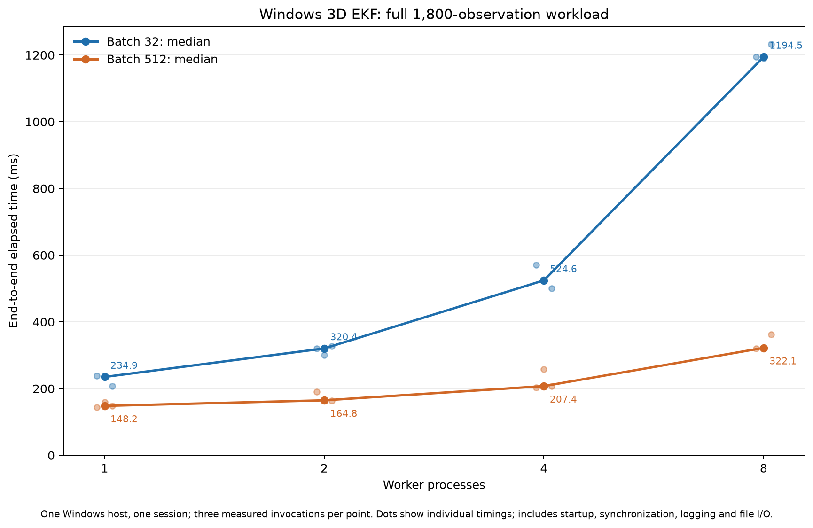
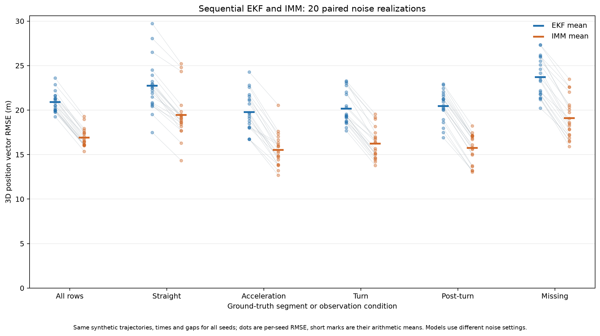

# Operating-System Interfaces and Multi-Process Radar Tracking

**CT-353 Operating Systems — Complex Computing Activity**

**Institution:** NED University of Engineering & Technology

**Team:** Muhammad Nouman Fazil (CT-24259), Muhammad Usman Murtaze (CT-24262), Muneeb ur Rehman (CT-24282)

> **Current report and evidence scope.** This is the consolidated report for the current branch. The older [Final_report_draft.md](Final_report_draft.md) and [report.md](report.md) retain historical content and are not the source of current claims. Controlled same-machine Linux–Windows performance evidence is not yet available; Ubuntu CI and local Windows results use different machines. The instructor's interpretation of the rubric's Windows interface count remains open.

## 1. Objectives and scope

The project demonstrates operating-system interfaces for file I/O, processes, memory, inter-process communication (IPC), and permissions on Linux and Windows. It integrates native file I/O, mapped arrays, multiple persistent processes, and synchronization into a radar tracking application. The shared 2D filter is retained as a baseline; the integrated application uses a nine-state 3D extended Kalman filter (EKF), and a separate sequential interacting multiple-model (IMM) extension explores more than one motion hypothesis.

The CCA asks for multi-process speedup as well as correctness. Multiprocessing is implemented and tested, but the saved Windows 3D experiment shows **slowdown**, not a speedup, for the configurations reported here. There is no supported claim that this workload speeds up or that one OS is generally faster.

## 2. Environment and evidence

The 3D Windows measurements used Windows 11 build `10.0.26300` on a Lenovo 21CUS07000 with an AMD Ryzen 5 5600U, 6 cores / 12 logical CPUs, 33,099,800,576 bytes RAM and Balanced power plan. The compiler was MinGW g++ 15.1.0 with C++17 and `-O2`. [The clean-checkout measurement manifest](../results/phase4/windows-clean-f6435cf/manifest.json) records exact commands, source revision, hashes, and sampling policy. A clean checkout and matching hashes are useful provenance but do not independently prove which source built a binary.

Native Linux functional verification uses GitHub-hosted Ubuntu 24.04, a different environment. [The Linux workflow](../.github/workflows/linux-verification.yml) builds and exercises the programs; its measurements are smoke tests, not comparable performance evidence. The historical project claimed a dual-boot HP workstation environment; the saved artifacts do not independently establish its provenance. Its older per-iteration benchmarks must not be mixed with the current persistent 3D measurements.

## 3. Part A: operating-system interfaces

The assignment names the following facilities. Corresponding cells have related purposes; they are not necessarily equivalent operations. Source directories contain demonstrations and benchmark code; the [requirement-to-evidence inventory](../docs/phase-0-baseline.md) connects each category to source, logs and saved results.

| Category | Linux interfaces | Windows APIs | Source |
|---|---|---|---|
| File I/O | `open`, `read`, `write`, `close` | `CreateFile`, `ReadFile`, `WriteFile`, `CloseHandle` | [Linux](../Linux/File_IO/), [Windows](../Windows/File_IO/) |
| Process | `fork`, `exec` (`execv` used), `wait` | `CreateProcess`, `WaitForSingleObject` | [Linux](../Linux/Process/), [Windows](../Windows/Process/) |
| Memory | `mmap`, `munmap` | `VirtualAlloc`, `VirtualFree` | [Linux](../Linux/Memory/), [Windows](../Windows/Memory/) |
| IPC | `pipe`, `shmget`, `shmat` | `CreatePipe`, `CreateFileMapping`, `MapViewOfFile` | [Linux](../Linux/IPC/), [Windows](../Windows/IPC/) |
| Permissions | `chmod`, `chown`, `umask` | `SetFileSecurity` | [Linux](../Linux/Permissions/), [Windows](../Windows/Permissions/) |

The table names **15 Linux interfaces and 12 Windows APIs**, although the assignment text refers to 15 for each OS. Supporting calls, including `UnmapViewOfFile`, serve implementation and cleanup; they are not silently presented as three additional named requirements. Instructor clarification is still needed. Windows process creation loads a program, whereas Linux `fork` duplicates a process and an `exec` family operation replaces its image. Windows security descriptors and Linux mode/ownership operations also have distinct semantics.

The demonstrations perform checks and record logs, and category benchmark CSVs record aggregate timing and CPU/memory-related fields ([Linux](../results/Linux/linux_results.csv), [Windows](../results/Windows/windows_results.csv)). Those CSVs are historical, and original per-invocation samples and independent execution provenance are unavailable. For example, their recorded `open` and `CreateFile` medians are 2.797 µs and 29.650 µs respectively, each over 1,000 iterations; they are individual historical measurements, **not an isolated comparison of identical calls or evidence of OS causation**. The differences in arguments, filesystem, caching, timing and setup require examination before interpreting a ratio. Linux timestamp-counter ticks and Windows process-cycle counts are not interchangeable CPU metrics. CPU loop overhead and cleanup are not always in the same timing scope, and memory deltas are not total memory usage. A complete audit of every supporting call and forced cleanup failure remains open ([Phase 1 status](../docs/phase-1-status.md)).

## 4. Tracking models and input

### 4.1 Baseline

The retained [2D core](../common/kalman_core.hpp) tracks X and Y independently with state `[position, velocity]` for each axis. Its constant-velocity transition is `F = [[1, dt], [0, 1]]`. The implemented continuous white-noise acceleration covariance is `Q = q [[dt³/3, dt²/2], [dt²/2, dt]]`, with default `q = 1500 m²/s³`; measurement variance defaults to `2500 m²`. This is not the discrete constant-acceleration impulse-noise covariance. The historical baseline's saved positional errors and benchmarks are preserved as historical observations with the provenance qualifications in the [baseline inventory](../docs/phase-0-baseline.md).

### 4.2 Three-dimensional EKF

The [3D EKF](../common/ekf3d.hpp) uses state `x = [px, py, pz, vx, vy, vz, ax, ay, az]ᵀ`, with metres, m/s and m/s². The sensor is at the origin and observes range, azimuth and elevation:

`h(x) = [sqrt(px²+py²+pz²), atan2(py,px), atan2(pz,sqrt(px²+py²))]ᵀ`.

The constant-acceleration transition uses the actual per-track time interval: `p' = p + v dt + ½a dt²`, `v' = v + a dt`, `a' = a`. For each axis, process covariance is `q [[dt⁵/20, dt⁴/8, dt³/6], [dt⁴/8, dt³/3, dt²/2], [dt³/6, dt²/2, dt]]` for continuous white jerk, `q = 25 m²/s⁵`. Radar variance is `[2500 m², 10⁻⁶ rad², 10⁻⁶ rad²]`. The first measurement initializes position; velocity and acceleration start at zero with conservative uncertainty.

The EKF uses an analytic measurement Jacobian, wraps angular innovations, solves the innovation system by Cholesky factorization, and uses Joseph-form covariance update. Missing observations trigger prediction only. Non-finite values, invalid timestamps and singular radar geometry are rejected. See the [model and numerical notes](../docs/phase-2-ekf3d.md).

The seed-42 scenario has three synthetic tracks, 600 time steps each, irregular intervals, observation gaps and straight, accelerating, turn-like and post-turn segments. The [generator](../common/generate_3d_scenario.py) writes measurement and ground-truth files separately; estimators receive only measurements. This is simulated data, not a real aircraft test.

### 4.3 Sequential IMM extension

The [IMM](../common/imm3d.hpp) maintains CV and CA EKF hypotheses in a common nine-coordinate embedding. The CV acceleration entries are zero placeholders after prediction, while CA acceleration entries describe physical acceleration. Before prediction, transition-weighted state/covariance mixing includes between-model covariance; the CV model then projects its acceleration coordinates to zero. A fixed per-observation transition matrix `[[0.97, 0.03], [0.03, 0.97]]` mixes modes. Model probabilities use Gaussian innovation likelihoods normalized in the log domain; no observation applies only the transition update. The fused covariance also includes between-model uncertainty.

The CV model uses continuous white-acceleration intensity `4 m²/s³` and the CA model the EKF's white-jerk intensity. The transition probabilities are per observation, so changing observation rate changes the implied switching rate. These settings are illustrative and not equally tuned across all models. The IMM currently runs through a **sequential driver**; the native persistent-worker applications run the single EKF. Full assumptions and commands appear in [Phase 5 notes](../docs/phase-5-imm.md).

## 5. Native architecture and correctness

The Linux program uses native file operations, a shared `mmap` arena, persistent `fork` workers, pipes and process waits. Windows uses native file operations, a named file mapping, `CreateProcess`, events and process waits. Measurements and result arrays reside in shared memory. The parent submits batches and waits for completion before reuse. Tracks are assigned by ID to a worker, so each worker maintains that track's state across batches and preserves temporal order. Batch size defaults to 128 and is configurable; workers are shut down after processing. Output is created only after successful computation; failed output writes may leave a partial new file. Logs trace parent and worker activity, but do not individually trace every setup/cleanup operation.

The [native integration notes](../docs/phase-3-parallel-ekf3d.md) document input limits, signaling, errors, execution commands and fault checks. Native 1/2/4/8-worker outputs were compared against sequential output for all exported state and position-covariance fields, including interleaved tracks and a 14,400-observation, 24-track workload. Test-instrumented startup and hung-worker failures exercise error propagation and worker shutdown. These checks are evidence for tested paths, not a proof of complete resource cleanup.

An independent EKF reference checks 120 updates using finite-difference derivatives and pivoted solves. An independent IMM reference checks all nine fused states, six exported position-covariance entries and both probabilities across 1,800 updates, including 123 missing observations; its numerical Jacobian and linear-system approach differ from the C++ implementation. Tests also check evidence-driven probability changes, transition-only missing-data behavior, covariance symmetry and selected quadratic forms. These checks do not prove accuracy over all geometries or numerical inputs.

## 6. Performance methodology and results

The saved clean-checkout Windows 3D experiment uses seed 42, 1 and 3 tracks, quarter/half/full selected observations, batch sizes 32 and 512, and 1/2/4/8 workers. It contains 48 configurations, one warm-up and three measured invocations per configuration. The harness rotates configuration order and validates each output against the sequential driver. [Raw samples](../results/phase4/windows-clean-f6435cf/samples.csv), [summary](../results/phase4/windows-clean-f6435cf/summary.csv), and [manifest](../results/phase4/windows-clean-f6435cf/manifest.json) are retained. The recorded elapsed time is the complete native invocation, including process startup, file I/O, logging, synchronization and shutdown. The following medians are milliseconds for all 1,800 observations across three tracks:

| Batch | 1 worker | 2 workers | 4 workers | 8 workers |
|---|---:|---:|---:|---:|
| 32 | 234.933 | 320.372 | 524.553 | 1,194.482 |
| 512 | 148.167 | 164.849 | 207.446 | 322.066 |

The one-worker native process is the baseline for the saved worker-count speedup, not the separately invoked sequential driver. For example, batch 512 with eight workers has `148.167/322.066 ≈ 0.460×` median speedup, a slowdown. Each listed larger-batch median is lower than its same-worker batch-32 median in this session. Startup, communication, synchronization and logging are plausible contributors, but these measurements do not isolate any one cause. Three samples in one session do not establish typical performance on other machines or workloads.

Internal timing fields separately record launch, first batch, aggregate later batches and shutdown. Launch covers creation, not verified readiness; later batches include synchronization and logging, not pure computation. Raw samples also record lifetime parent CPU, summed worker CPU, parent peak memory and largest single worker peak. OS accounting differs, `-1` means unavailable, and shared pages can occur in multiple working sets; those peaks cannot be summed as unique physical memory. The [measurement protocol](../docs/phase-4-measurements.md) gives field definitions and limitations.

The separate seed-42 sequential comparison records five measured processes after one warm-up per model, alternating order. It reports 90.230 ms median for the EKF and 103.952 ms for the IMM. These timings include executable startup and CSV I/O and are not an isolated computation benchmark. [Comparison evidence](../results/phase5/windows-0e59a69/manifest.json) includes individual samples and hashes.

## 7. Accuracy and motion diagnostics

For seed 42, all-row Euclidean vector RMSE includes prediction-only gaps. The separate [EKF accuracy](../results/phase5/windows-0e59a69/ekf-accuracy.json) and [IMM accuracy](../results/phase5/windows-0e59a69/imm-accuracy.json) reports use identical measurements and truth:

| Error | EKF | IMM |
|---|---:|---:|
| Position (m) | 20.774 | 16.392 |
| Velocity (m/s) | 25.832 | 22.472 |
| Acceleration (m/s²) | 6.451 | 1.844 |
| Missing-observation position (m) | 24.252 | 18.353 |

On 20 noise seeds using the same three synthetic trajectories, time steps and gaps, the mean of per-seed position RMSEs was 20.888 m for the EKF and 16.891 m for the IMM; the IMM was lower in all 20 seeds. Straight, acceleration, turn and post-turn segment results and all per-seed values are in the [multi-seed evidence](../results/phase5/multiseed-fe04715/README.md). These are means of RMSEs, not pooled RMSE. The settings use different process noise and one scenario family; this result cannot be generalized to other motion or real sensors. The [model probability plot](../results/phase5/multiseed-fe04715/seed42-probabilities.svg) illustrates changes over time, but average mode probabilities do not prove reliable maneuver classification.

For the EKF on the 1,677 available observations, raw XY RMSE is 52.535 m, the existing 2D baseline is 24.069 m and 3D EKF XY is 19.443 m. This comparison uses the same noisy radar observations, but the baseline assumes fixed Cartesian noise, while polar-to-Cartesian uncertainty depends on range; it is not a comparison of optimally tuned models. Position NEES and ellipsoid coverage in the [Phase 4 analysis](phase4_results.md) are descriptive diagnostics, not independent-sample confidence intervals or proof of calibration.

## 8. Lessons, remaining work and conclusion

Persistent workers preserve state and reduce repeated worker creation within an invocation, but short workloads can still spend substantial time in startup, synchronization, logging and I/O. The measured multi-worker slowdown should be reported rather than explained as a proven kernel-specific effect. Stable numerical methods, explicit missing-data behavior and model-probability checks improve reviewability, while model complexity does not guarantee accuracy improvements beyond the tested conditions.

Remaining work before claiming full assignment compliance is a controlled, equivalent-work Linux–Windows comparison with preserved raw samples and environment details; further systematic cleanup/failure-path auditing; and instructor clarification of the Windows interface count. More trajectory families, independent timing sessions and real sensor data would strengthen the estimator evaluation. The synthetic tests and unequal platform environments support the narrower conclusions above, not a general OS ranking or universal model superiority.

## 9. Mapping to grading criteria

| Rubric criterion | Supporting evidence | Qualification |
|---|---|---|
| Diverse resources (CA-1) | Both native implementations, C++/Python tools, [CI workflow](../.github/workflows/linux-verification.yml), [reference tests](../tests/check_imm3d_reference.py), measurement manifests | Linux CI and Windows local hardware differ. |
| Technical issues (CA-2) | [Coverage inventory](../docs/phase-0-baseline.md), [failure tests](../tests/check_ekf3d_faults.py), logs and IPC design | Full supporting-call cleanup audit and Windows count clarification remain open. |
| Innovation (CA-3) | Persistent processes, mapped arrays, 3D nonlinear radar EKF and sequential IMM | IMM is not integrated into native workers; performance benefit is not assumed. |
| Implementation and usability (CA-2) | [Shared core](../common/ekf3d.hpp), validation, separate measurement/truth files, [build and run documentation](../README.md) | Numerical and failure tests cover finite cases. |
| Performance and impact (CA-2) | [Raw timing/resources](../results/phase4/windows-clean-f6435cf/), [accuracy comparisons](../results/phase5/multiseed-fe04715/) and charts | No controlled cross-platform performance result is available. |

## 10. References and reproduction

The assignment's two supplied CT-353 CCA rubric PDFs define the requested interfaces and grading criteria. The repository's [README](../README.md) provides current build and execution instructions; [Phase 4](../docs/phase-4-measurements.md) and [Phase 5](../docs/phase-5-imm.md) provide the exact evaluation workflows. Preserved data and manifests linked above identify the runs used in this report. The original historical bibliography appears in [Final_report_draft.md](Final_report_draft.md); historical conclusions there have not been adopted here.
